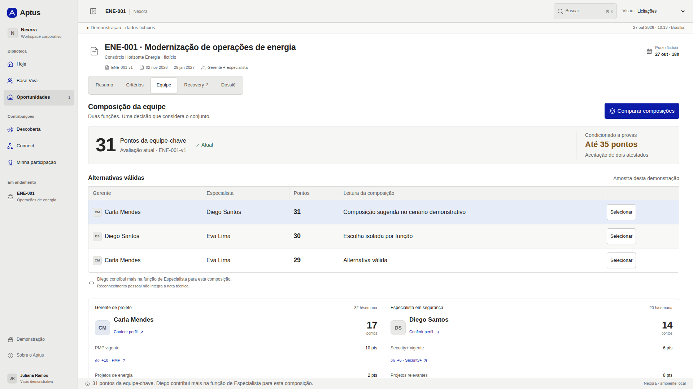

# Aptus

Projeto da equipe Quatro e meio, do CEFET-MG, para o desafio D03 da EloGroup no HackatOhm 2026. A Nexora é a empresa fictícia apresentada no case.

O Aptus reúne qualificações profissionais, documentos e regras de editais para ajudar a montar equipes e preparar propostas técnicas. Cada parcela da nota fica ligada ao critério e à comprovação que a sustentam.

A arquitetura proposta usa **Java 21 com Spring Boot**, **RAG** sobre documentos autorizados e **modelos locais da família Qwen** para geração e embeddings. O **Jev** complementa a análise semântica por API, quando autorizado. PostgreSQL/pgvector armazena os dados e apoia a busca; OR-Tools CP-SAT faz a composição de equipes. A [especificação](docs/aptus-3.1/APTUS_3_1_Blueprint.md) detalha o papel de cada componente.

O repositório inclui uma demonstração de interface em React, com dados fictícios e processamento simulado. O backend Java e as integrações com os modelos ainda não estão implementados.

## Por onde começar

| Para | Acesse |
| --- | --- |
| Assistir ao pitch | [Vídeo final, versão 4](https://github.com/santana-iago/hackatohm/releases/tag/pitch-v4) |
| Rodar a demonstração | [Protótipo de demonstração](prototype/aptus-demo/README.md) |
| Ler o resumo | [PDF de duas páginas](docs/entrega-2026/revisao-modelo-oficial/D03_Quatro_e_meio_Resumo.pdf) · [Word editável](docs/entrega-2026/revisao-modelo-oficial/D03_Quatro_e_meio_Resumo.docx) |
| Entender a arquitetura | [Especificação Aptus 3.1](docs/aptus-3.1/APTUS_3_1_Blueprint.md) · [PDF](docs/aptus-3.1/APTUS_3_1_Blueprint.pdf) |
| Encontrar os demais materiais | [Índice da documentação](docs/README.md) · [Lista de arquivos](docs/INDICE_DE_ARQUIVOS.md) |

## Rodar o protótipo

Requisitos: Git, Node.js 22.12 ou superior e npm.

```bash
git clone https://github.com/santana-iago/hackatohm.git
cd hackatohm/prototype/aptus-demo
npm ci
npm run dev
```

Abra o endereço informado pelo Vite, normalmente `http://localhost:5173`. O protótipo funciona com dados fictícios e estado local. Não exige conta, chave de API ou banco de dados.

Para gerar e abrir o build:

```bash
npm run build
npm run preview
```

O [README do protótipo](prototype/aptus-demo/README.md) explica as telas, as cenas prontas, a exportação do PDF e os comandos de teste.



## O fluxo do Aptus

O projeto parte de informações dispersas entre currículos, RH e gestão de projetos. A proposta é manter essas informações atualizadas e separar o que foi declarado do que está documentado e aceito em cada edital.

1. Base Viva reúne perfis, experiências e comprovantes, com origem e histórico.
2. Edital e equipe relaciona os critérios às qualificações e compara composições possíveis.
3. Recovery identifica documentos faltantes e mostra o ganho possível se forem aceitos a tempo.
4. Descoberta encontra competências ainda ausentes do cadastro.
5. Connect recebe indicações e encaminha a confirmação das qualificações.
6. Dossiê reúne equipe, fontes, memória de cálculo e aprovações.

Na demonstração, a composição conjunta chega a 31 pontos. Duas provas adicionais, verificadas e aceitas, permitem recalcular para 33 e depois 35. Enviar um documento por si só não aumenta a nota. Pontos de reconhecimento por participação são separados da pontuação do edital.

## O que está implementado

| Parte | Situação |
| --- | --- |
| Protótipo em React, TypeScript e Vite | Navegação, revisão documental, comparação de equipes, Recovery, cenas reproduzíveis e PDF local, com processamento simulado. |
| Scripts em Python | Extração de currículos Word, análise exploratória, busca de editais e um teste inicial de correspondência. |
| Arquitetura de produção | Java 21/Spring Boot, RAG, PostgreSQL/pgvector, Docling, Qwen local para geração e embeddings, Jev por API e OR-Tools CP-SAT. Especificada; implementação e integrações pendentes. |

O código executável da demonstração está em [`prototype/aptus-demo/`](prototype/aptus-demo/). As regras e os contratos previstos para o produto estão na [especificação](docs/aptus-3.1/APTUS_3_1_Blueprint.md). Os resultados do cenário são ilustrativos; os ganhos operacionais dependem de um piloto.

## Organização

| Pasta | Conteúdo |
| --- | --- |
| [`prototype/aptus-demo/`](prototype/aptus-demo/) | Aplicação, testes, instruções, capturas e PDF demonstrativo. |
| [`docs/aptus-3.1/`](docs/aptus-3.1/README.md) | Arquitetura, regras, modelo de dados e critérios de aceite. |
| [`docs/entrega-2026/`](docs/entrega-2026/README.md) | Resumos, diagramas, referências e materiais da apresentação. |
| [`docs/video/`](docs/video/README.md) | Pitch, roteiros e materiais de gravação. |
| [`docs/arquivo/`](docs/arquivo/README.md) | Planejamento inicial e registros de preparação do evento. |
| [`src/`](src/README.md) | Scripts exploratórios em Python e instruções de uso. |
| [`data/editais/`](data/README.md) | Exemplos de editais e critérios estruturados. |

## Equipe

Quatro e meio, Engenharia de Computação do CEFET-MG:

- Iago Soares Santana, líder;
- Gabriel Galvão dos Reis Bandeira;
- Bernardo Vieira Rocha;
- Lucas Francischetti Alvarenga;
- Arthur de Oliveira Torres.

Mentores do desafio: Daniel Hasan Dalip e Poliana Aparecida Corrêa de Oliveira.

## Dados e colaboração

O protótipo usa pessoas e documentos fictícios. Os currículos fornecidos no desafio e suas extrações não fazem parte do repositório; o relatório exploratório conserva contagens agregadas e identificadores anonimizados.

Para propor mudanças, consulte [como contribuir](CONTRIBUTING.md). Fontes, premissas e limitações estão registradas nos documentos correspondentes.
