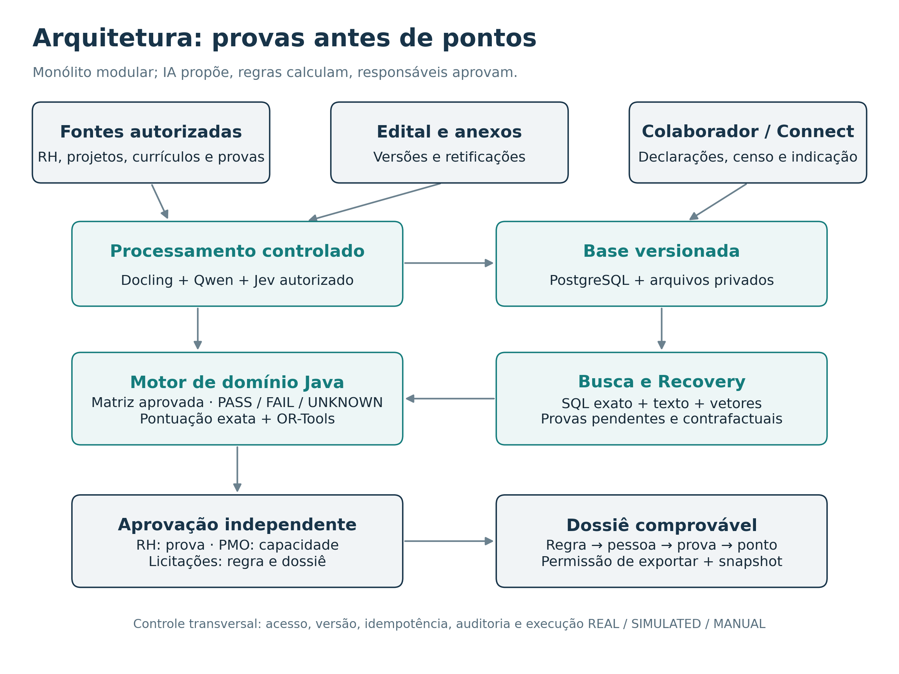
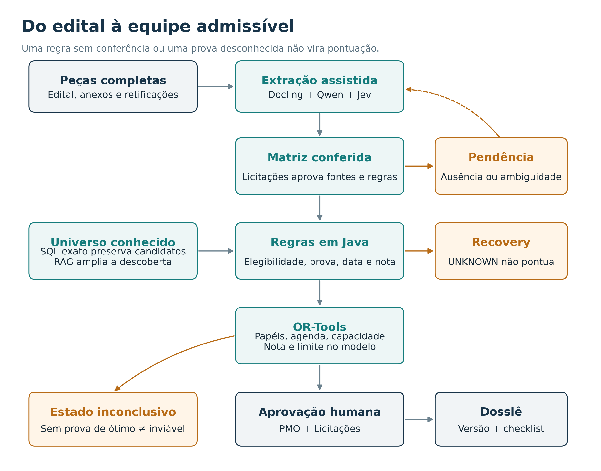
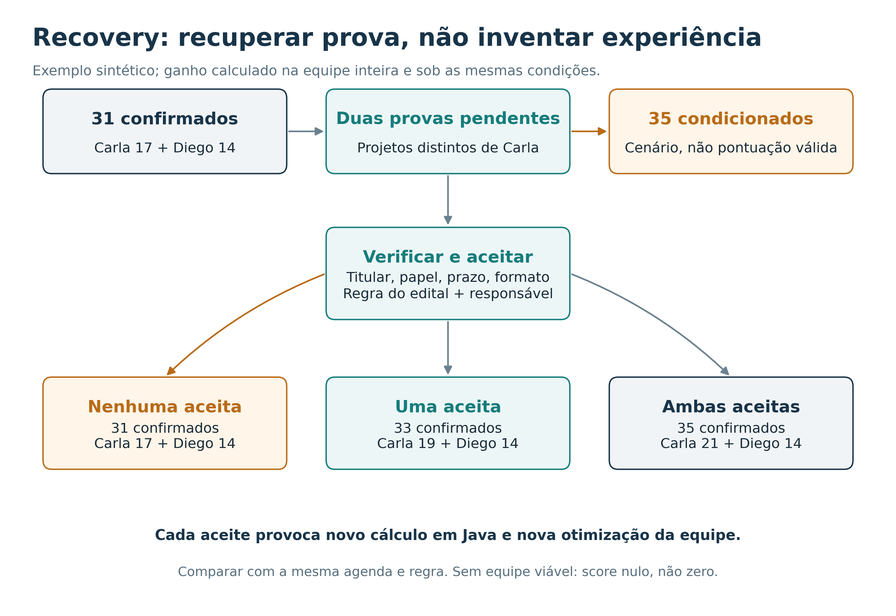

# APTUS 3.1 — Inteligência de Propostas Técnicas Comprováveis

**Especificação funcional, técnica e de validação | HackatOhm 2026 — Desafio D03, EloGroup**  
**Empresa fictícia:** Nexora  
**Versão:** 3.1, revisão de engenharia 1 | 26 de outubro de 2026  
**Equipe:** [conferir nome cadastrado na inscrição] | CEFET-MG  
**Situação:** arquitetura e regras propostas; não é declaração de produto implementado ou homologado.  
**Identidade:** APTUS é o nome oficial da solução desde 27/10/2026; a revisão 3.1 preserva integralmente o projeto antes chamado Lastro.

**Escopo desta revisão:** corrigir contratos, regras e ambiguidades dentro da arquitetura existente. Permanecem os mesmos módulos, tecnologias, seis pipelines e cenário principal. Os ajustes estão incorporados nas seções correspondentes; o registro `APTUS_3_1_Correcoes_Engenharia.md` relaciona cada correção aos testes de aceite. Especificação corrigida não significa implementação já corrigida ou testada.

> **Tese central.** O Aptus busca a melhor composição de profissionais **comprovadamente admissível dentro das informações disponíveis e da versão aprovada do edital**, informa se essa otimalidade foi demonstrada, mostra quais pontos técnicos ainda podem ser recuperados antes do prazo e gera um dossiê rastreável. Sua base de competências se atualiza a partir de eventos corporativos, participação ativa e comprovações — não apenas da memória dos gestores.

## 1. Sumário executivo e delimitação

A pergunta da EloGroup é: **como encontrar rapidamente os profissionais mais aderentes a cada disputa, apresentar suas experiências da melhor maneira possível e manter a base atualizada?** [1] O Aptus responde com três capacidades integradas: (i) uma **Base Viva de Evidências**, (ii) um **Motor de Admissibilidade e Composição de Equipes** e (iii) um **Aptus Recovery**, que localiza provas ausentes, estima seu impacto real e coordena sua recuperação. O **Dossiê de Proposta** fecha o ciclo. Descoberta de competências, indicações e gamificação mantêm a base viva.

O diferencial não é prometer que uma IA acerta uma licitação: é **transformar cada ponto da recomendação em uma trilha verificável que um gestor pode examinar**. A decisão permanece sujeita às regras aprovadas do edital, às provas efetivamente aceitas e à confirmação humana.

**O que o Aptus não promete:** vitória na disputa; inexistência de erros; detecção de competências jamais registradas; validade automática de todo certificado autêntico; otimização do preço de proposta; substituição de jurídico, RH ou PMO; uso de dados reais sem autorização. Seu escopo principal é a **parcela da proposta técnica associada à equipe-chave**, com referências a outros critérios somente para evitar afirmar que otimizou a nota total.

### 1.1 Diagnóstico ancorado no problema real

O case descreve mais de 1.000 profissionais e cerca de **40 disputas por ano**. Em cada disputa, **2 a 3 gestores consomem *juntos* 15–25 horas** localizando e ajustando currículos. Isso corresponde a **600–1.000 horas agregadas/ano**, não a duas ou três vezes esse valor [1]. Os currículos ficam dispersos, têm formatos variados, envelhecem, podem duplicar pessoas e não representam a validade e a prova das experiências.

Uma análise exploratória da equipe sobre **228 currículos de teste** indicou **142 arquivos sem certificação detectada pelo dicionário/regex** e **45 com seção explícita de certificações** [2]. Isso **não** significa que 142 profissionais não sejam certificados: revela limite da declaração e do método de extração. As contagens devem ser reproduzidas antes de serem usadas como resultado quantitativo final; esses arquivos não devem ser enviados a provedores externos sem a autorização exigida pelo regulamento.

**Prova externa de que a falha importa:** na Concorrência 02/2026 da AMEP-PR, a empresa Lima Engenharia foi desclassificada porque o coordenador geral indicado somou **6 pontos**, abaixo do mínimo **8**, e o edital exigia **dois profissionais distintos** para dois papéis. Na mesma ata, registros de experiência foram aceitos ou recusados conforme tipologia e documentação. O exemplo mostra que ter um currículo impressionante não equivale a satisfazer um critério formal [3]. Não se afirma que o Aptus teria revertido aquela decisão.

### 1.2 Objetivo verificável

Em um edital com critérios previamente aprovados, o Aptus deve conseguir: **(a)** recuperar todos os profissionais elegíveis conhecidos no cadastro estruturado; **(b)** rejeitar qualquer pontuação baseada apenas em alegação; **(c)** enumerar as restrições que impedem composições; **(d)** exibir a pontuação calculada e a prova de cada parcela; **(e)** recalcular depois de uma alteração validada; **(f)** preservar versão, autoria e integridade da proposta; **(g)** mostrar quando a resposta permanece inconclusiva.

## 2. Decisões de arquitetura — fechadas e justificadas



| Camada | Escolha recomendada | Limite de responsabilidade |
|---|---|---|
| Aplicação | **Java 21, Spring Boot, monólito modular** | APIs, identidade, regras, validação, decisões objetivas e estados. |
| Banco | **PostgreSQL** | Fonte de verdade; entidades relacionais, versões, auditoria, outbox e SQL exato. |
| Busca | PostgreSQL textual/SQL + **pgvector** | Recuperação híbrida de fontes autorizadas; não decide pontuação. |
| Vetorização | **Qwen3-Embedding-0.6B**, fixado e local | Busca multilíngue; reindexação controlada ao trocar versão. |
| Extração | **Docling** em worker Python isolado | Texto, tabelas, páginas e coordenadas; preservação do original. |
| LLM gerativo | **Qwen3.5-4B**, executado localmente | Propostas de fatos/cláusulas em schema fechado e redação fundamentada; não aprova. |
| Julgador semântico | **Jev 1.14.0**, mediante autorização | Classificação tipada de ambiguidade e aderência de evidências; sem cálculos ou decisão final. |
| Otimização | **Google OR-Tools CP-SAT Java** | Alocação inteira com restrições e diagnóstico de status; não interpreta editais. |
| Orquestração | Jobs transacionais + **outbox PostgreSQL** no MVP; DBOS opcional após benchmark | Retentativas idempotentes e recuperação; não requer plataforma distribuída no hackathon. |
| Arquivos | Repositório privado versionado; IDs e hashes no banco | Originais e snapshots; hash comprova integridade, **não autenticidade**. |
| Interface | Web acessível e responsiva | Telas para gestor, RH, PMO, colaborador e Licitações; visibilidade por papel. |

**Por que Java e não Python ou Go no núcleo?** As rotinas críticas são CRUD, avaliação determinística de regras, acesso a banco e otimização. Java fornece tipagem, testes, integração Spring e API estável. O gargalo potencial não é a interpretação do backend: é extração documental, revisão e inferência. **Docling permanece Python por adequação do ecossistema**, isolado por contrato de serviço. Microsserviços, Kubernetes e banco de grafos separados não são necessários para a escala descrita sem métricas que os justifiquem. OR-Tools possui interface Java e estados operacionais diferenciados [5].

**Condição para Jev externo:** autorização documental e jurídica antes de transmitir qualquer dado dos currículos fornecidos ou dados profissionais; em caso contrário, somente dados sintéticos gerados pela equipe no hackathon. A API oficial anuncia Jev `jev-1.14.0` e US$ 0,042 por milhão de tokens **de entrada**, sem cobrança de saída, em 26/10/2026 [6]; isso não representa custo operacional completo ou SLA. O modelo Qwen3.5-4B é uma opção aberta Apache-2.0, mas sua qualidade, memória e latência no hardware disponível **ainda exigem benchmark** [7].

### 2.1 Limites de autonomia

**Qwen extrai e propõe; Jev classifica semanticamente; Java valida e pontua; OR-Tools compõe; pessoas verificam e aprovam.** A IA nunca assina documentação, certifica autenticidade, aprova vínculo, atribui pontos por similaridade nem transforma uma interpretação ambígua em certeza. Se os modelos falharem, existe fila humana; o sistema não retorna `PASS` por omissão.

## 3. Contratos de domínio e princípios invariantes

### 3.1 Quatro eixos de estado — nunca um único status linear

Uma competência não pode ser descrita apenas como “declarada → comprovada → verificada → válida”. Há quatro perguntas independentes:

1. **Origem da alegação:** `DETECTADA`, `DECLARADA`, `CONFIRMADA_PELO_TITULAR`, `CONTESTADA`.
2. **Qualidade da prova:** `SEM_DOCUMENTO`, `RECEBIDA`, `EM_VERIFICACAO`, `VERIFICADA`, `REJEITADA`, `REVOGADA`.
3. **Validade temporal:** `VALIDA_NA_DATA`, `VENCIDA_NA_DATA`, `SEM_PRAZO_APLICAVEL`, `DESCONHECIDA` — avaliada para uma data de referência específica, sem apagar o histórico.
4. **Aceitação para edital:** `PASS`, `FAIL`, `UNKNOWN` para cada combinação `(tender_version, rule_id, person_id, role_id, evaluation_at)`.

Um certificado verificado pode estar vencido; um certificado válido pode não atender ao nível exigido; um atestado legítimo pode não comprovar o **papel exercido**. Fonte não localizada deixa a competência desconhecida. Se uma exigência documental tem prazo encerrado, o sistema pode concluir `FAIL` **da apresentação tempestiva** quando houver dados suficientes e nenhuma possibilidade processual aplicável em aberto; isso não significa que a pessoa não possui a competência. `PASS` exige todas as condições da regra. `FAIL` exige fundamento suficiente e identifica qual condição falhou; casos incompletos ficam `UNKNOWN`.

### 3.2 Graus de verificação de evidências (política operacional)

| Nível | Evidência disponível | Uso para pontuação confirmada |
|---|---|---|
| E0 | Declaração/extração, sem documento | Nunca. Gera busca e censo. |
| E1 | Arquivo presente e associado a titular presumido | Nunca por si só. Exige conferir titular e pertinência. |
| E2 | Documento legível e consistente com identificadores/datas | Ainda não garante autenticidade. |
| E3 | Verificação por responsável autorizado ou fonte emissora, registrada com evidência e data | Pode sustentar um critério, se o edital a aceitar. |
| E4 | E3 **e** decisão de admissibilidade específica do edital, com regra/versão e condições documentais cumpridas | Habilita pontuação confirmada daquela regra. |

**E4 não é “certificação universal”**: a mesma prova pode receber E4 para um edital e `FAIL` para outro. Um hash ou OCR perfeito não elevam automaticamente o nível. Sempre registrar o método de conferência, quem conferiu, qual fonte foi consultada e quais limitações existem.

### 3.3 Invariantes a codificar e testar

- Nenhuma pontuação sem `PASS` e comprovação formalmente aceita na data aplicável.
- Pontuação e elegibilidade são reprodutíveis com `rule_version + evidence_version + profile_version + availability_snapshot + calculation_version`.
- A pessoa possui identificador canônico; duas versões de currículo não representam duas vagas ou dois projetos.
- Fonte documental sem direito de acesso **não participa nem da recuperação RAG**; modelos só recebem trechos autorizados.
- Cada projeto real é contado conforme a regra, não conforme o número de documentos anexados; deduplicação por identidade do projeto, escopo, pessoa, papel e intervalo.
- O mesmo profissional não pode ocupar duas funções simultâneas quando isso for proibido; conflitos de agenda/horas e reservas são restrições explícitas.
- `UNKNOWN` em eliminatória bloqueia condição *confirmada*, mas abre alternativa/censo/validação em vez de excluir silenciosamente para sempre.
- Um resultado `FEASIBLE` do solver não será publicado como matematicamente ótimo; mesmo `OPTIMAL` exige conferir objetivo, fase, escala e limite de otimalidade. `MODEL_INVALID` e `UNKNOWN` têm encaminhamento próprio.
- Recuperação de documento não aumenta pontos até verificação e **nova execução integral das regras e da otimização**.
- Gamificação e indicação não pontuam nas licitações nem influenciam requisitos obrigatórios.
- Retificação, vencimento, revogação, perda de disponibilidade ou alteração de política exigem reavaliar os usos afetados conforme o alcance temporal do evento. A decisão histórica não é apagada nem reescrita.
- `DOSSIE_EQUIPE_APROVADO` exige checklist, agenda/vínculo quando aplicável, aprovações, atualidade conferida do edital e autorização de exportação. Significa somente aprovação da parcela de equipe-chave no escopo avaliado; não declara a proposta integral pronta, enviada ou aceita.
- Condições exigidas da mesma experiência compartilham a mesma pessoa, participação, projeto e período aplicável. Provas de experiências diferentes não podem ser combinadas para fabricar atendimento.
- Restrições de reutilização e tetos compartilhados são aplicados à equipe inteira; a nota final é conferida pelo motor Java antes de ser publicada.
- Toda saída do protótipo registra `REAL`, `SIMULATED` ou `MANUAL` por etapa — sem demonstrar uma integração fictícia como real.

## 4. Modelo de dados mínimo e sua rastreabilidade

| Agregado/entidade | Chave e campos essenciais | Governança |
|---|---|---|
| `Person` | `person_id`, `hr_external_id?`, vínculo, unidade, `status` | Identidade única, desambiguação humana. |
| `Claim` | `claim_id`, `person_id`, `kind`, título normalizado, origem e versão | Alegação independente de documentação. |
| `Evidence` | `evidence_id`, `subject_type/id`, `storage_key`, `sha256`, emissor, titular, datas, versão, ACL, política de compartilhamento | Documento privado; consulta e exportação são permissões diferentes. |
| `EvidenceCheck` | `check_id`, método, revisor, decisão, data conhecida, início/fim do efeito e limitação | Rastreia E1–E3 e alcance temporal das revogações. |
| `Project` | `project_id`, cliente/setor, escopo, datas | Identifica projeto único. |
| `Participation` | pessoa, projeto, função real, períodos, vínculo com evidências | Não confundir participação com responsabilidade técnica. |
| `Credential` | competência, emissor, identificador, datas e estado | Vigência avaliada conforme data da regra. |
| `TenderVersion` | edital/anexos/retificações, hash, prazos/fuso, versão aprovada, última conferência da fonte oficial | Versionamento append-only; atualidade externa não presumida. |
| `TenderRule` | versão, expressão, vínculos da experiência, provas admitidas, caps, reutilização, fase e fonte | DSL sem execução arbitrária; interpretação aprovada. |
| `ClauseCoverage` | arquivo, página, bloco, classificação, mapeamento ou justificativa de exclusão | Evita omissões silenciosas. |
| `EligibilityDecision` | pessoa, papel, requisito, datas/fase, PASS/FAIL/UNKNOWN, testemunhas e versões das provas | Explicação reproduzível e contestação. |
| `Availability` | janela/granularidade, capacidade, reservas e condições, exclusividade, confirmação PMO, validade | Trata propostas concorrentes sem disponibilidade fictícia. |
| `TeamScenario` | seleção pessoa×papel, unidades de prova usadas, nota conferida, objetivos por fase, status/bounds, universo/versão | Certifica somente o que o modelo efetivamente demonstrou. |
| `RecoveryTask` | regra, prova pendente, titular, prazo/fase, custo, status, baseline e intervenções, limites do impacto | Workflow verificável; hipótese não vira ganho confirmado. |
| `Referral` | indicador, convite, aceitação, validação, escopo, indicador externo/interno | Não publicar dados externos antes de aceitação. |
| `EngagementEvent` | ação, prova, pontos, cap e política vigente | Independente do score técnico. |
| `DossierSnapshot` | escopo equipe-chave, anexos/textos finais, hashes, cálculos, versões/políticas, aprovadores e pacote exportado | Aprovação do conteúdo exato; exportação não prova entrega. |
| `AuditEvent` e `OutboxEvent` | autor, alteração, justificativa, correlação/idempotência | Registro resistente a duplicação. |

**Tempo e versões:** armazenar `valid_from/valid_to` (quando algo era verdadeiro no mundo) separadamente de `recorded_at` (quando o sistema soube), `issued_at` (emissão do documento) e `verified_at` (conferência). Cada regra define a data ou o intervalo em que a condição deve existir, a fase processual e o prazo de apresentação da prova. Instantes têm fuso; datas sem hora conservam essa precisão, sem inventar meia-noite ou disponibilidade exata. Limites inclusivos/exclusivos e cálculo de duração são explícitos e testados.

Uma prova emitida depois pode retratar um fato anterior, mas sua admissibilidade depende do regime, da fase e da decisão competente. O Aptus não cria uma autorização automática de juntada tardia nem a proíbe universalmente. Se houver diligência formal aplicável, registrar autorização, prazo e fundamento; não alterar retroativamente o pacote originalmente entregue. As condições de habilitação tratadas pelo art. 64 não serão estendidas automaticamente à pontuação da proposta técnica [14].

**Relações como grafo sem novo banco:** `Person → Participation → Project → Evidence → Issuer`, com chaves estrangeiras e índices no PostgreSQL. O grafo localiza hipóteses de prova; **uma aresta não implica aceitação**.

**Provas compostas e conflitantes:** uma evidência pode comprovar a empresa, e não o profissional. `EvidenceBundle` reúne atestado empresarial, participação nominal, registro profissional e outros documentos quando a regra permitir esse conjunto. O conjunto deve registrar os vínculos comuns de identidade, projeto, papel e período; duas fontes verdadeiras de projetos diferentes não se completam quando a regra exige a mesma experiência. Fontes contraditórias geram `UNKNOWN/CONFLICT`, salvo precedência objetiva aprovada; não selecionar a fonte que dá mais pontos.

**Efeito de revogação:** registrar quando foi conhecida, desde quando produz efeito e quais usos alcança. Revogação com efeito futuro não reprova automaticamente uma situação válida no corte anterior; invalidade comprovada desde a origem exige revisar os usos históricos correspondentes. Alcance desconhecido gera revisão, não a interpretação mais favorável. Manter a decisão original e a decisão de reavaliação vinculadas ao evento. Certificação com vigência exigida durante a execução deve ser reavaliada nesse intervalo, mesmo se estava válida na submissão.

## 5. Edital → DSL de regras jurídicas e técnicas



**A regra é uma representação estruturada de uma interpretação já validada por Licitações/Jurídico**, nunca código arbitrário criado pela IA. Cada edital possui `manifest` de todas as peças recebidas, inventário de páginas, anexos e retificações, apontamento de cláusulas relevantes e excluídas, justificativa, responsabilidade e assinatura de aprovação.

### 5.1 DSL restrita, com suporte explícito

Tipos permitidos inicialmente: `REQUIRE_CERT`, `REQUIRE_DEGREE`, `MIN_YEARS`, `COUNT_DISTINCT_PROJECTS`, `MIN_PROJECT_SCOPE`, `REQUIRE_PROOF_TYPE`, `MIN_ROLE_SCORE`, `ROLE_COUNT`, `NO_ROLE_OVERLAP`, `AVAILABILITY`, `AFFILIATION`, `POINTS_PER_UNIT`, `CAP`, `SUM`, `DATE_CUTOFF`, `EVIDENCE_FORMAT`, `REQUIRES_APPROVAL`.

Operadores permitidos: `AND`, `OR`, `NOT`, comparações sobre datas e inteiros, contagens `distinct`, `min/max` e condicionais documentais. Sem `eval`, SQL/AQL arbitrário, scripts, regex gerada livremente ou expressões Java dinâmicas. Caso o edital traga fórmula ou condição fora da linguagem suportada: `UNSUPPORTED_REQUIRES_REVIEW` e inclusão manual de uma regra testada, antes de pontuar.

**Lógica de três valores obrigatória:** `NOT UNKNOWN = UNKNOWN`. Em `AND`, qualquer `FAIL` determina `FAIL`; todos `PASS` determinam `PASS`; os demais casos são `UNKNOWN`. Em `OR`, qualquer `PASS` determina `PASS`; todos `FAIL` determinam `FAIL`; os demais casos são `UNKNOWN`. Exemplo: PMP comprovado **ou** equivalente desconhecido resulta `PASS`, não reprovação. Nunca converter ausência de informação em negação booleana. Uma pontuação opcional `UNKNOWN` vale zero **confirmado** naquele componente e mantém a pendência, sem alterar automaticamente a elegibilidade do papel.

**Mínimo de pontos eliminatório:** se a soma comprovada alcança o mínimo, a condição é atendida; se está abaixo e existe prova pendente que poderia atingi-lo, permanece `UNKNOWN`. Só concluir `FAIL` quando o limite máximo possível dentro das regras e das informações suficientes também ficar abaixo do mínimo. Limites contrafactuais não viram pontos confirmados.

Cada regra de contagem declara `count_unit` (projeto, contrato, atividade, participação ou período), `distinct_by`, `cap_scope` (pessoa, função, equipe ou proposta), `reuse_policy`, escala/arredondamento e datas de corte. Um projeto pode legitimamente comprovar duas pessoas quando o edital permitir; dois PDFs sobre o mesmo projeto não o transformam em dois. Experiência temporal distingue união de intervalos, soma de durações e continuidade: dois projetos simultâneos de cinco anos não viram dez anos se a regra mede tempo de calendário. `>10 anos` é diferente de `>=10 anos`. Validade na submissão é diferente de validade no início ou durante toda a execução.

**Conjunção dentro da mesma experiência:** a DSL declara a unidade à qual cada condição se aplica e seus vínculos. Para “gerente em projeto de energia com pelo menos 24 meses”, existe uma participação identificada que precisa satisfazer setor, função e duração conjuntamente. Energia por seis meses em P1 e gerência por 24 meses em P2 de saúde não atendem. Documentos complementares de P1 podem compor a prova se todos os vínculos forem consistentes. Ausência de testemunha suficiente permanece `UNKNOWN` quando o conjunto de informações está incompleto; `FAIL` exige fundamento suficiente. Relações não suportadas pelo compilador ficam em revisão, sem achatamento para uma lista de booleanos.

**Unidade pontuável não é arquivo:** os documentos sustentam unidades de contagem; o identificador dessas unidades é que governa reutilização e tetos. `EligibilityDecision` guarda os IDs das participações/unidades e das provas escolhidas. Notas individuais são pré-calculadas apenas para regras comprovadamente separáveis. Regras compartilhadas seguem para a composição conjunta descrita na seção 7.

Exemplo de contrato sintético (não corresponde a edital real):

```json
{
  "schema_version": "1.1",
  "tender_version": "ENE-001-v1",
  "rule_id": "PM-ENERGY",
  "role": "PROJECT_MANAGER",
  "kind": "SCORING",
  "source": {"file": "edital-v1.pdf", "page": 4, "clause": "7.2.1"},
  "cutoff": "2026-10-27",
  "eligibility_rule_refs": ["PM-PMP-OBRIGATORIO"],
  "metric": "COUNT_DISTINCT_PROJECTS",
  "count_unit": "PROJECT",
  "distinct_by": ["project_id", "person_id", "role"],
  "project_filter": {"sector": "ENERGY", "role": "PROJECT_MANAGER"},
  "witness_binding": {
    "unit": "PARTICIPATION",
    "same_unit_fields": ["person_id", "project_id", "role"],
    "document_join": "CONSISTENT_REFERENCES"
  },
  "accepted_proof_types": ["CLIENT_ATTESTATION"],
  "points_per_unit": 2,
  "cap": 8,
  "cap_scope": "PERSON_ROLE_RULE",
  "reuse_policy": "ALLOW_ACROSS_PERSONS_WITH_OWN_PROOF",
  "rounding": "INTEGER_EXACT",
  "approved_by": "LICITACOES-TESTE",
  "approval_status": "APPROVED"
}
```

O código traduz esse JSON para regras tipadas e executa testes gerados para suas bordas (limiar exato, vencimento, duplicidade, cap, ausência de prova). A aprovação deve identificar também as condições eliminatórias e os critérios de desempate.

**Separação obrigatória:** `PM-PMP-OBRIGATORIO` é uma eliminatória própria. A pós-graduação é uma regra pontuável independente e sua ausência vale zero, não desclassificação. Cada regra tem seus próprios tipos de prova. O termo `PASS` representa **aceitação interna segundo o edital interpretado e aprovado**, não homologação automática pela entidade que julgará a licitação. O dossiê torna a conclusão defensável, mas não garante sua aceitação externa.

### 5.2 Conferência de cobertura

1. O sistema lista cada arquivo e retificação esperado, com checksum. Arquivo ausente **bloqueia o status de matriz completa**.
2. Docling extrai páginas/tabelas. Qwen **sugere** blocos com origem; Jev **classifica ambiguidade e tipo** apenas em contexto autorizado.
3. Licitações confere mapeamento e trechos ainda `UNMAPPED`; um trecho “irrelevante” precisa ter justificativa registrável, não apenas desaparece.
4. Nenhuma regra nova é aplicada antes de revisão humana. A aprovação sela `tender_version + rule_set_version`.
5. Retificação gera nova versão, `diff` de critérios e recálculo de decisões/dossiês afetados.

**Atualidade externa:** manifesto completo significa completo em relação às peças conhecidas, não ausência garantida de nova publicação. A aprovação registra fonte oficial consultada, responsável, horário, peças identificadas e resultado da consulta. Licitações define a renovação dessa conferência no fechamento. Sem conferência válida, a interface não afirma “última versão oficial”; registra `ATUALIDADE_NAO_CONFIRMADA`. Fonte indisponível não é consulta bem-sucedida. Este controle pode ser manual; não cria integração ou pipeline de monitoramento.

**Verificação contra edital real:** comparar campos extraídos com avaliação humana em um conjunto de cláusulas rotulado. A meta não é afirmar 100% de cobertura a priori; é **impedir aprovação silenciosa de conteúdo ainda não conferido**.

## 6. Busca e elegibilidade sem exclusão semântica

**Duas rotas separadas:**

- **Rota exata (sem ANN/Top-K):** SQL sobre competências normalizadas, IDs canônicos, evidências, validade e regras. Percorre **todos** os candidatos estruturados potencialmente elegíveis, respeitando permissões, sem truncar por similaridade.
- **Rota de descoberta:** SQL textual + embeddings + RAG sobre textos autorizados, campanhas abertas e indicadores corporativos. Sugere pessoas e provas que não estavam estruturadas. Um `Top-K` vetorial **nunca pode eliminar alguém conhecido e elegível**; retornos apenas geram novos `Claim/Evidence` e revisão.

`PASS` é calculado por Java para cada requisito e pessoa **com evidência suficiente**; `FAIL` se existe evidência ou condição inequívoca impeditiva; `UNKNOWN` se falta prova ou interpretação. Candidatos com `UNKNOWN` aparecem na **lista de recuperação**, não como elegíveis confirmados para ocupar funções mandatórias. Resultados de busca devem informar cobertura, filtros exatos aplicados e itens não processados.

**Teste de regressão obrigatório:** um perfil elegível conhecido que usa terminologia diferente (“PMP”, “Project Management Professional”, número do certificado) deve permanecer no universo da busca exata mesmo quando a similaridade vetorial for baixa. Análise de recall de descoberta deve ser separada da garantia de não exclusão estruturada.

**Universo conhecido não é empresa inteira:** guardar versão do conjunto de candidatos, unidades/fontes incluídas, importações pendentes e cobertura autorizada. Mostrar “melhor composição no universo analisado”, não “melhor equipe de toda a Nexora” quando há bases não integradas. Não contornar permissões para aumentar cobertura; indicar a limitação ao responsável autorizado sem vazar dados protegidos.

## 7. Formulação da otimização e seus estados

Para o MVP, `y[p,r] ∈ {0,1}` é a **seleção nominal** da pessoa `p` para o papel `r` durante todo o horizonte requerido. A disponibilidade é conferida em cada período `t` sem trocar silenciosamente a pessoa selecionada entre semanas. Rodízio/substituição só entra se o edital permitir e houver aprovação específica. O CP-SAT é inteiro: escalonar notas quando necessário. Restrições mínimas:

```text
Para cada papel:            Σp y[p,r] = vagas[r]
Condições individuais:     y[p,r] <= PASS_INDIVIDUAL[p,r]
Papéis incompatíveis:       Σr∈incompatíveis y[p,r] <= 1
Capacidade por período t:   Σr carga[r,t] * y[p,r] <= capacidadeConfirmada[p,t]
Vínculo/edital:             y[p,r] <= vinculoPermitido[p,r,edital]
Recursos e orçamento:       custoEquipe <= limiteAprovado, se houver limite
```

`PASS_INDIVIDUAL` abrange apenas condições independentes da composição. Mínimos de nota e condições que compartilhem unidades de prova são restrições conjuntas do modelo; não se usa uma nota individual incompatível com a alocação final para pré-aprovar a função. A verificação posterior cobre ambas as classes. Prova pendente não é variável livre que o solver possa tratar como aceita; existe somente em cenário contrafactual nomeado.

Se não houver agenda confirmada, o sistema pode apresentar **cenário condicionado** (fora do resultado aprovado), mas jamais publicar a pessoa como definitivamente alocável. `Availability` registra a granularidade exigida: uma soma semanal suficiente não comprova presença em dois horários coincidentes. Quando o edital exigir horários, presença física ou deslocamento, a confirmação deve abranger essas condições; caso contrário permanece pendente. Isso detalha o contrato de disponibilidade existente, sem ampliar o MVP para um sistema completo de escalas.

**Reservas condicionais:** cada reserva declara janela, carga, condição de ativação, exclusividade, responsável e prazo de validade. Duas propostas podem ser ganhas; não assumir que são mutuamente exclusivas só porque ainda não foram adjudicadas. Reservas condicionais não equivalem a compromissos confirmados. O PMO registra as combinações que podem coexistir e a resolução de conflitos; sem solução aprovada, o cenário permanece condicionado. A promoção a compromisso confirmado verifica a capacidade de todos os compromissos simultaneamente exigíveis. A verificação ocorre mesmo entre aprovações sequenciais, não apenas em corridas de transação. A expiração é conferida contra o relógio no comando de aprovação, mesmo sem alteração de versão no banco.

**Composição da prova junto da equipe:** `ScoringEngine` entrega componentes pontuáveis e suas restrições; `TeamOptimizer` resolve seleção de pessoas e uso das unidades quando há compartilhamento. Por exemplo, a unidade X vale 6 pontos e só pode ser usada uma vez na proposta. A gerente e B especialista têm X; C especialista tem Y, que vale 4. A+B vale 6, não 12; A+C vale 10. Se cada papel exigir mínimo 6, X não pode satisfazer simultaneamente os dois mínimos. O modelo vincula cada uso à pessoa selecionada, à regra, à unidade e às provas aceitas, respeitando `cap_scope` e `reuse_policy`. Não basta somar notas individuais já fechadas.

Antes de publicar, `ScoringEngine` reavalia a equipe e a alocação retornadas por um caminho de cálculo determinístico que não confie no valor informado pelo solver. Divergência bloqueia o resultado como `RESULT_VALIDATION_FAILED`. Testes usam respostas manuais e enumeração de instâncias pequenas para reduzir erros compartilhados entre compilador e conferência. Uma prova que precise ser entregue, mas não tenha autorização de exportação para aquele destinatário, não sustenta ponto utilizável no dossiê confirmado; permanece oportunidade documental ou exige prova alternativa permitida.

**Objetivo lexicográfico configurável:** (1) satisfazer todas as eliminatórias; (2) maximizar a **nota técnica de equipe** conforme DSL; (3) aplicar os desempates editalícios pertinentes à equipe, na ordem aprovada; (4) só então aplicar preferências internas de custo confirmado, capacidade e dependência. Critérios fora do escopo ou não modeláveis permanecem explícitos; não se declara ótimo para eles. Critérios comerciais não editalícios **não podem alterar nota técnica publicada**. Mostrar até 2–3 alternativas distintas se existirem, sem apresentá-las como as melhores seguintes sem demonstração. Uma escolha comercial diferente registra justificativa humana, não um falso ótimo editalício.

| Status do CP-SAT | Tradução fiel na interface | Próxima ação |
|---|---|---|
| `OPTIMAL` | Sucesso segundo objetivo e tolerâncias configurados; conferir o certificado antes de declarar ótimo exato | Conferir objetivo, fase, nota e limite; depois revisão PMO/Licitações. |
| `FEASIBLE` | Composição admissível encontrada, sem prova de ótimo | Oferecer alternativa e tempo adicional. |
| `INFEASIBLE` | Nenhuma composição atende **o modelo informado** | Explicar conflitos; Recovery e revisão de dados/regra. |
| `MODEL_INVALID` | Modelo inconsistente/inválido | Bloquear e corrigir modelagem/testes. |
| `UNKNOWN` | Prazo de solução esgotou ou estado indeterminado | Não alegar ótimo nem ausência de equipe. |

O OR-Tools documenta todos os cinco estados. Sua definição de `OPTIMAL` também abrange sucesso em problemas só de viabilidade e encerramento dentro do gap configurado; logo, o rótulo bruto não basta para afirmar máxima pontuação [5,13]. Em viabilidade prática, a confirmação da equipe deve ser um **ponto formal de decisão do PMO**, com responsável e validade temporal.

**Implementação do objetivo:** otimizar nota primeiro; se o ótimo foi provado, fixar esse valor e otimizar os critérios seguintes em etapas, preservando a ordem editalícia. Uma soma de pesos arbitrários não pode sacrificar uma prioridade estrita. “Risco” usa medidas documentadas (ex.: margem de capacidade e validade mínima), não um número inventado pelo Jev. Mapear restrições para IDs e fontes. Um conjunto de conflitos informado pelo solver não será denominado causa mínima de inviabilidade sem que isso tenha sido demonstrado.

**Contrato do resultado:** guardar em `TeamScenario` o hash do modelo e das entradas, universo de candidatos, versão do solver, objetivo/direção por fase, escala de pontos, parâmetros, solução conferida, melhor limite e motivo de encerramento. Sem objetivo de nota compilado, não existe certificado de otimização da nota. No modo exato, fixar limites de gap absoluto e relativo em zero; conferir ainda que o limite exclua qualquer valor melhor na escala inteira adotada. Escalonamento e arredondamento obedecem à DSL, com faixas numéricas validadas contra overflow e perda de precisão na interface. Caso não suportado exige revisão.

`solver_status` permanece o retorno original; `technical_optimum_proven` é uma conclusão validada à parte. Se a fase da nota fecha em 35 e a de custo termina apenas viável, a nota pode ser ótima sem que o custo o seja. O manifesto informa a certificação por fase. `UNKNOWN` sem solução não significa inexistência de equipe; `INFEASIBLE` é sempre relativo às restrições e ao universo informados. Uma solução anterior pode ser conservada apenas após revalidação explícita nas condições atuais, nunca por reutilização cega do cache.

### 7.1 Cenário sintético de ponta a ponta — números fechados

Regra **fictícia e didática**, com dois papéis distintos:

- **Gerente**: PMP válido = **10**, pós-graduação aceita = **5**, cada projeto distinto de energia com prova aceita = **2**, até **8** de energia. PMP é eliminatório.
- **Especialista**: Security+ válido = **6** e cada projeto aceito relevante = **2**, até **8** de projetos. Security+ é eliminatória.
- Só **uma pessoa por função**, sem acumulação; disponibilidade deve estar confirmada.

| Pessoa | Gerente | Especialista | Composição de pontos e situação |
|---|---:|---:|---|
| Bruno | 21 | — | PMP 10 + pós 5 + 3 projetos × 2 = 21; **indisponível**. |
| Carla | 17 | — | PMP 10 + pós 5 + 1 projeto × 2 = 17; **disponível**. |
| Diego | 18 | 14 | Gerente: PMP 10 + 4 projetos × 2 = 18; especialista: Security+ 6 + 4 projetos × 2 = 14; **disponível em todo o horizonte requerido, um papel apenas**. |
| Eva | — | 12 | Security+ 6 + 3 projetos × 2 = 12; **disponível**. |

Escolha local ingênua: **Diego gerente (18) + Eva especialista (12) = 30**. Solução de composição: **Carla gerente (17) + Diego especialista (14) = 31**. O benefício demonstrado é **+1 ponto por otimizar a equipe inteira**.

O Aptus Recovery encontra dois **outros projetos independentes** de energia de Carla, ainda sem atestados aceitos. Não pontuam. O painel mostra **31 confirmados** e **35 como cenário potencial condicionado**. Sem nova prova aceita, permanece **31**. Com **uma** nova prova aceita, Carla passa de 17 para 19 e a melhor equipe chega a **33**. Com **ambas** aceitas antes da data de corte, Carla passa para **21** (10 + 5 + 3×2), e a equipe fica **35 pontos confirmados após reotimizar**. Recusa ou atraso da segunda prova não anula a primeira prova válida. Nenhum atestado será contado duas vezes e nenhum estado é apresentado como prova real no hackathon.

**Status no vídeo:** dados/provas de Carla, Bruno, Diego e Eva são **sintéticos**; solver real somente se de fato executado e testado. A pergunta da banca “por que 35?” é respondida por duas provas distintas, datas de corte, aprovação e memória de cálculo.

## 8. Os seis pipelines operacionais

Cada pipeline possui entrada, estado, saída e proprietário. As chamadas de modelos são etapas nomeadas, não ações livres de um agente. **O plano define Qwen e Jev para as etapas semânticas**, mas tarefas puramente mecânicas — alerta de vencimento, soma, controle de acesso — não consomem inferência.

| Pipeline | Caminho e saída | Responsável final / falha segura |
|---|---|---|
| **A — Base Viva** | Upload/evento → identidade provisória → Docling → Qwen extrai fatos com fontes → Jev classifica categoria/ambiguidade → Java valida schema → titular/RH confere → evidência versionada e índice atualizado. | RH; arquivo ilegível fica pendente, preservado. Não gera ponto. |
| **B — Edital e equipe** | Peças completas → Qwen propõe regras → Jev aponta ambiguidades → Licitações aprova matriz → busca híbrida + SQL exato → Java pontua → CP-SAT compõe → Jev analisa riscos qualitativos nas alternativas → PMO/Licitações aprovam. | Licitações/PMO; regra não aprovada ou `UNKNOWN` crítico impede confirmação. |
| **C — Recovery** | Lacuna → busca autorizada por provas/participações → Qwen resume a prova necessária → Jev classifica encaminhamento → tarefa com responsável e prazo → prova verificada → nova execução das regras/solver. | Licitações; nada muda no score antes da aprovação. |
| **D — Descoberta** | Requisito sem cobertura → pergunta/campanha → Qwen formula solicitação com vocabulário normalizado → Jev classifica retorno → titular fornece prova → RH verifica → reindexação. | RH; silêncio é desconhecido, não ausência de competência. |
| **E — Connect** | Indicação interna ou convite externo → aceite do indicado → evidências fornecidas pelo titular → Qwen normaliza → Jev classifica → RH verifica → decisão de elegibilidade para aquela oportunidade. | RH; indicado externo não vira empregado nem integrante confirmado. |
| **F — Dossiê** | Equipe/regras/provas aprovadas → Qwen redige currículo direcionado → Jev sinaliza extrapolação semântica → Java valida referências e checklist → Licitações aprova os artefatos finais → snapshot e exportação. | Licitações; divergência impede aprovar o dossiê da equipe. Não atesta a proposta integral. |

**Fechamento do pipeline F:** o estado de negócio é `DOSSIE_EQUIPE_APROVADO`, com `scope=KEY_TEAM`. Exportação registra `EXPORTED` e o hash do pacote exato. Qwen não reescreve textos depois do aceite; reprocessar ou editar cria nova versão sujeita à aprovação. Permissão de exportar, validade temporal, versões e reservas são verificadas novamente no ato da exportação. Um registro posterior de entrega, se usado, fica no `AuditEvent` já existente, com operador, destino, pacote e evidência de protocolo/recebimento. Não existe envio automático nem declaração de recebimento baseada apenas no download.

### 8.1 Recovery como gestão de pendências, não “criação de provas”

Uma tarefa deve guardar `rule_id`, prova exigida, fonte potencial, pessoa responsável, dependências, prazo de emissão, prazo de submissão, custo/horas de obtenção, estado de verificação e **ganho marginal no cenário de equipe inteiro**. Estados: `OPEN`, `IN_PROGRESS`, `WAITING_EXTERNAL`, `RECEIVED`, `ACCEPTED`, `REJECTED`, `DEADLINE_EXPIRED`, `CANCELLED`.

Viabilidade operacional: `VIAVEL`, `INCERTA` ou `INVIAVEL`, informada a partir de fonte, responsável e prazo — **não uma probabilidade inventada pelo modelo**. A prioridade é lexicográfica: pendência eliminatória e prazo crítico; impacto demonstrado ou limitado pelo contrafactual; esforço/custo; dependências. Um intervalo inconclusivo não é substituído por uma estimativa favorável. Metas de pontos nunca autorizam pressionar a emissão de atestado falso ou alterar descrição do trabalho realizado.

O potencial é calculado ativando **somente as provas hipotéticas nomeadas**, reaplicando tetos, dependências, uso das unidades, limite de papéis e agenda. Diferenças de pontuação **não podem ser somadas novamente** entre tarefas que competem pelo mesmo teto. O painel deve mostrar combinações de tarefas mutuamente compatíveis, não apenas cartões com “+4” acumuláveis.

Quando a equipe atual é inviável, `baseline_score = null`, não zero. A recuperação pode **restabelecer viabilidade**; o delta de pontos só é exibido entre cenários comparáveis, com mesma regra e mesmas demais condições. Se Bruno ficar disponível, por exemplo, o baseline do cenário da seção 7 pode já ser 35: não se pode continuar atribuindo +4 de ganho à prova de Carla.

**Não confundir soluções encontradas com ótimos:** para maximização, cada execução válida informa o valor de uma equipe conferida L e um limite superior U. Com baseline em [L0,U0] e cenário em [L1,U1], a diferença entre os ótimos está contida em [L1 − U0, U1 − L0]. Os limites devem ter a mesma escala e objetivo primário; sem solução ou limite válido, o delta fica inconclusivo. Só restringir a diferença a valores não negativos quando for demonstrado que a intervenção apenas adiciona opções válidas, sem retirar provas, introduzir conflito ou mudar restrições.

Exemplo de falha a impedir: antes, melhor encontrada 30 e limite 40; depois, encontrada 35 e limite 40. Os ótimos podem ser 40 nas duas execuções. Não publicar “+5 recuperados”; o intervalo geral é [−5,10], ou [0,10] na adição puramente monotônica comprovada. Quando ambos os ótimos são demonstrados, 31→35 significa +4 no cenário comparável. Enquanto as provas forem hipotéticas, mesmo esse +4 exato permanece **condicionado**, não confirmado.

O painel distingue nota confirmada da equipe escolhida, melhor valor encontrado, limite de otimalidade e impacto contrafactual. Baseline `UNKNOWN` sem solução seguido de equipe viável significa “viabilidade demonstrada agora”, não “inviabilidade anterior resolvida”. Após aceitar documentos, recalcular e registrar a comparação válida; isso demonstra efeito no cenário, não causalidade de aumento de vitórias ou prova de que o processo manual não recuperaria os mesmos documentos.

### 8.2 Descobrir o que não estava no currículo

Três caminhos coexistem: (a) campanha dirigida por competência/oportunidade; (b) quadro aberto de oportunidades para qualquer colaborador se manifestar; (c) eventos corporativos autorizados (conclusão de projeto, comunicação do certificado, reembolso de exame). **Reembolso não comprova aprovação** e fim de projeto não comprova todas as funções: esses eventos criam rascunhos a confirmar.

Exemplo Security+: a competência não consta na base; o sistema divulga a demanda e aceita declaração de qualquer área. Um colaborador responde, envia prova e a conferência torna a informação utilizável. Se não houver fonte ou resposta, permanece desconhecida. Nenhuma IA adivinha a certificação.

### 8.3 Base viva: processo, capacidade e responsáveis

RH é dono do cadastro; PMO confirma participação e agenda; Licitações define aceitação documental; o titular corrige fatos. Eventos importantes geram rascunhos, não formulários inteiros. Revisão de perfil é sugerida **a cada 90 dias**; certificações recebem alertas em **90/30 dias** antes do vencimento, parametrizáveis. São políticas iniciais, não exigências legais.

A fila humana precisa de capacidade e SLA. Para o piloto, medir entradas/semana, tempo por conferência e backlog; definir um limite de trabalho em andamento. Se a fila exceder capacidade, priorizar eliminatórias/próximos prazos e reduzir ingestão indiscriminada. A proposta **não é viável** se apenas deslocar o trabalho dos gestores para um RH sobrecarregado. Registrar esforço total de todas as áreas nas métricas.

Revisão periódica deve ser **incremental** e orientada ao que mudou. Exemplo hipotético: 1.000 perfis × 4 revisões/ano × 3 minutos = **200 horas anuais** só de revisão. Reutilizar verificações ainda válidas, documentar responsáveis substitutos e sinalizar `RISCO_DE_PRAZO` quando a fila exceder capacidade antes da submissão.

## 9. Indicações e gamificação sem distorção da seleção

**Connect interno:** o indicador aponta uma oportunidade/competência, o indicado confirma ou contesta e o verificador independente valida. O indicador não aprova sua própria indicação nem a do grupo sob conflito de interesses. Reconhecimento só após contribuição válida, sem dupla contagem de uma prova.

**Connect externo:** por padrão, a empresa fornece **link de convite** para o colaborador compartilhar com o interessado. A plataforma só recebe os dados profissionais depois de a própria pessoa aceitar o aviso de privacidade e fornecer os documentos. Se a empresa desejar coletar contato por indicação antes disso, precisará justificar finalidade/base legal, minimização e retenção. O aceite do convite não substitui vínculo admissível, documentação, consentimento de participação específico, agenda ou contratação.

### 9.1 Política inicial de engajamento

| Ação validada | Pontos exemplificativos | Controle |
|---|---:|---|
| Nova certificação comprovada | +10 | Uma vez por credencial/renovação efetiva; não por upload. |
| Experiência antes ausente, com prova aceita | +5 | Projeto/participação único. |
| Indicação interna confirmada | +3 | Sem autovalidação; não por número de convites. |
| Indicação externa aceita com qualificação verificada | +8 | Um evento por pessoa indicada; prazo de verificação. |
| Correção relevante comprovada | +3 | Revisão independente e trilha do ajuste. |

Proposta inicial: **teto 30 pontos por mês**, sem ranking nominal público; metas individuais e indicadores agregados por área. Valores configuráveis e sujeitos a validação de RH no piloto. **Sem pontos negativos por não responder**, sem punição a licenças/afastamentos, sem premiação por número de certificados irrelevantes. Auditar fraudes, indicações cruzadas e favoritismo.

**Recompensa preferencial:** reconhecimento, feedback de contribuição e oportunidades de desenvolvimento com critérios acessíveis. Todos os elegíveis devem poder consultar e receber oportunidades; a comunicação não será restrita aos maiores pontuadores. **Prioridade de participação em projetos não será comprada por pontos**. Empates técnicos seguem política auditável de RH/PMO; gamificação não substitui evidência nem favorece rede de amizades. Remuneração, bônus ou PLR não integram o MVP; dependem de política própria e avaliação trabalhista, sem presumir que pagamento pontual elimina riscos.

### 9.2 Preservar a inteligência para capacitação, sem alegações indevidas

O painel de lacunas permanece: competências frequentemente exigidas, provas vencendo, pontos recuperáveis e investimentos possíveis. Entretanto, **coocorrência/EASE não mede chance de uma pessoa obter uma certificação em dois meses**. No piloto, recomendar trilhas a partir de pré-requisitos documentados, interesse do colaborador, prazo disponível e orçamento. EASE pode ser pesquisa futura comparada a uma regra simples, sem impacto na elegibilidade ou promessa de previsão individual. Uma lacuna de documentação não deve ser contabilizada como lacuna de capacidade.

## 10. Modelos de IA: contratos, custo e avaliação

### 10.1 Interfaces e rastreabilidade

Cada adaptador recebe dados mínimos e retorna schema fechado. Todas as saídas contêm `run_id`, `input_hash`, `source_refs`, `model_id`, `prompt_version`, `schema_version`, `execution_mode`, `created_at`, `status` e `latency_ms`. Campos novos ou referências inexistentes são rejeitados. O conjunto de fontes pode ser verificado no código, mas **a mera existência da referência não prova que ela sustenta a afirmação**: por isso há validação semântica e revisão dos itens críticos.

```json
{
  "run_id": "RUN-DEMO-001",
  "input_hash": "sha256-do-snapshot",
  "source_refs": ["DOC-101:p4:b12"],
  "model_id": "jev-1.14.0",
  "prompt_version": "eligibility-semantic-v1",
  "schema_version": "1.0",
  "execution_mode": "SIMULATED",
  "created_at": "2026-10-26T21:00:00-03:00",
  "latency_ms": null,
  "status": "REVIEW_REQUIRED",
  "decision": "EVIDENCE_POSSIBLY_RELEVANT"
}
```

Jev não recebe a lista inteira de colaboradores: recebe perguntas delimitadas sobre trechos autorizados. Pinning de versão evita alteração silenciosa de comportamento. Limites oficiais consultados: **64k tokens por requisição, 32k por pergunta**; não ativar contexto estendido no MVP [6]. Emissões de probabilidade são scores do modelo, **não percentuais jurídicos de certeza**. Não adotar limiar 0,8 como “comprovação”: o piloto precisa calibrar por tarefa e pelo custo do erro. Os números e datas são tratados em Java.

### 10.2 Benchmark antes de escolher “o melhor” modelo

Criar um conjunto de **120 pares requisito×prova** (meta inicial, ainda não executada): 40 `PASS`, 40 `FAIL`, 40 `UNKNOWN`, incluindo português/inglês, negações, papéis similares, certificado vencido, projeto duplicado, evidência de empresa versus pessoa, tabela ruim e prompt injection. Essa composição é um conjunto de desafio; não representa a frequência desses casos na operação. Dois revisores rotulam os casos críticos de forma independente e registram a resolução de divergências.

Separar desenvolvimento de prompts, calibração e avaliação final **por grupos de origem**: documentos de um mesmo projeto, versões, traduções e exemplos derivados ficam na mesma partição. Definir o tratamento de modelos de documento muito semelhantes e registrar o número de documentos/projetos independentes; 120 pares não equivalem a 120 fontes independentes. Congelar o conjunto final antes do ajuste. A avaliação também inclui documentos completos para medir cláusulas omitidas e erros de extração; pares previamente selecionados não medem cobertura do edital inteiro.

Comparar: **A)** SQL+busca textual+revisão; **B)** A+Qwen; **C)** A+Qwen+Jev; **D)** C+busca semântica multilíngue. Manter as mesmas regras aprovadas, universo autorizado, solver, limite de execução e protocolo de revisão nas quatro condições. Assim, melhora do otimizador ou da base não é atribuída indevidamente ao modelo. Esses são ensaios da arquitetura escolhida, não propostas de substituí-la. Um ensaio isolado de extração conserva as mesmas fontes; um ensaio de descoberta pode ampliar as fontes recuperadas, mas registra esse efeito separadamente.

Medir falsas aceitações, desconhecidos tratados corretamente, recall de descoberta, revisão humana, tempo humano e tempo de máquina separados, custo e resultado por tipo de documento. Registrar erro sugerido pela IA, erro corrigido pelo revisor e erro residual na saída. Dois modelos concordarem não constitui verificação independente da verdade. Incluir como controle o comportamento “sempre UNKNOWN”: ele pode ter zero falsas aceitações e nenhuma utilidade. A solução precisa reduzir trabalho ou melhorar cobertura mantendo os controles, sem esconder uma fila humana crescente. **Zero erros na amostra não prova risco zero**; relatar denominadores, partições e casos ausentes.

**Gate conservador de produção:** nenhum `PASS` automático baseado apenas em classificação semântica. Para liberar automação adicional, exigir política de risco aprovada, ganho medido contra baseline e monitoramento. Jev indisponível → retentativas limitadas com backoff → fila manual. Qwen indisponível → ingestão pendente/manual. Um modelo local alternativo só substitui o Jev após a **mesma suíte de avaliação**, não como troca presumidamente equivalente.

### 10.3 Memória, contexto e segurança de inferência

O tamanho nominal de 4 bilhões de parâmetros não define sozinho RAM/VRAM, velocidade ou custo. Registrar hardware, quantização, tamanho de contexto, concorrência, batch e tempo de aquecimento. Documentos longos são segmentados por estrutura, mantendo página e anexos; nunca truncar sem aviso. A chave técnica do embedding inclui documento/versão, versão da segmentação e modelo. Isso não concede acesso: cada recuperação reaplica a política vigente, inclusive após mudança de permissão. Caches de respostas também distinguem conjunto de fontes, prompt, schema e contexto autorizado; nunca retornam uma decisão anterior sem conferir validade e versões. Modelos rodam em worker isolado com quotas; nenhum tem acesso direto a credenciais do banco nem ferramentas de escrita administrativa.

## 11. Confiabilidade operacional e segurança

### 11.1 Operações transacionais e falha segura

Para o protótipo/piloto, uma tabela `job` com estados `QUEUED/RUNNING/SUCCEEDED/FAILED/REVIEW_REQUIRED`, chave de idempotência, lock/lease, contador de tentativas e timeout é suficiente se testada. Persistir atualização e `outbox` na **mesma transação**. Processamento é “pelo menos uma vez”; efeitos devem ser idempotentes. Não afirmar “exatamente uma vez” ponta a ponta sem comprovação. Evitar que uma retentativa conceda recompensa, emita dossiê ou registre prova em duplicidade.

Idempotência é delimitada por organização, operação e alvo, vinculada ao hash do payload normalizado e à versão esperada. A mesma chave com conteúdo diferente retorna conflito; não reutiliza o sucesso anterior. O worker só grava resultado se ainda possui o token/geração da execução vigente. Expiração de lease e retentativa não autorizam um worker atrasado a sobrescrever o sucessor. Dados de auditoria e autoria são obtidos da sessão autenticada; autorizações são verificadas no servidor, não por esconder botões na interface.

Usar **concorrência otimista/versionamento** nas aprovações: se provas, regra ou agenda mudarem entre a leitura e a aprovação, retornar conflito e exigir revalidação. Snapshot final só após uma transação verificar versões e assinaturas. Um envio externo já realizado não pode ser “desfeito” reescrevendo histórico: gerar ocorrência, versão sucessora e ação de Licitações.

Um cálculo antigo que termina depois de uma retificação é marcado `STALE` e não substitui o atual. Reservas de capacidade são confirmadas em transação com controle de concorrência: duas aprovações simultâneas não podem comprometer a mesma capacidade. Cada execução tem manifesto de entradas e hash próprios.

**Contingência manual:** exportação da matriz, lista de provas e cálculos aprovados, com carimbo temporal; operador pode seguir processo manual sob mesmas regras. Não usar indisponibilidade do software para dispensar documentos obrigatórios. O operador registra ações, responsáveis, horários, novas provas, reservas e eventual pacote entregue durante a indisponibilidade. No retorno, `WorkflowService` e `AuditService` conciliam esses registros com as versões e compromissos atuais. Decisões afetadas permanecem pendentes até resolver conflitos; não é necessário bloquear processos independentes. Uma restauração de backup não transforma o estado antigo em realidade atual nem autoriza repetir uma entrega.

### 11.2 Controle de acesso e ameaças

- Autenticação corporativa no piloto; contas de demonstração explicitamente fictícias no hackathon. Menor privilégio, segregação entre RH, PMO, Licitações e operação técnica.
- ACL aplicada **antes** de recuperar trechos e antes de fornecer documentos aos modelos. Índice vetorial não é zona pública; evitar vazamento via resumo, snippet, citação, cache e exportação.
- `READ_INTERNAL` não equivale a `EXPORT_FOR_TENDER`: cada evidência tem política de compartilhamento, destinatário/finalidade e restrições de NDA. A prova pode ser consultável internamente e proibida no dossiê do cliente; esse caso exige solução documental ou permanece bloqueado. Redação/anonimização só quando não destruir a força da prova.
- Upload com limites de tamanho/formato, inspeção de malware, parser isolado, bloqueio de macros e links externos automáticos. Não baixar URLs arbitrárias contidas em documentos nem permitir SSRF no validador de certificados.
- Texto recuperado é **dado não confiável**. Instruções em um PDF não alteram prompts, ferramentas ou permissões. Testar arquivos adversariais; RAG não elimina prompt injection [9].
- Criptografia em trânsito e repouso, segredos fora do código, logs sem documentos integrais, links temporários autorizados, backups e teste de restauração.
- Auditoria de acesso/exportação e mudanças sensíveis; retenção configurada por finalidade. Integridade de logs e snapshots não autoriza retenção indefinida de dados pessoais.
- Política de exclusão inclui arquivo, índices, caches e cópias operacionais; backups seguem prazo e controles compatíveis. Dados minimizados não eliminam obrigação de proteção.
- Snapshots são imutáveis **durante retenção autorizada**, não eternos. Retenção excepcional/legal hold exige fundamento e revisão. Exclusão de cópias já enviadas a terceiros não pode ser garantida pelo sistema; registrar destinatários e processo aplicável.

### 11.3 LGPD e licitações: o que realmente precisa de aprovação

O fluxo profissional interno depende de finalidade e base legal definidas pela empresa; **não presumir consentimento como resposta universal**, especialmente na relação de trabalho. Documentos podem incluir dados desnecessários: eliminar/minimizar antes de indexar ou enviar a terceiros. Convites externos, gestão de talentos e uso em propostas são finalidades relacionadas, mas não idênticas; informar o titular e controlar a retenção. A revisão de decisões exclusivamente automatizadas e a explicação de critérios são direitos previstos na LGPD; o Aptus oferece contestação e **revisão humana efetiva**, não mero botão de confirmação [10].

Uso externo de Jev exige avaliação de contrato, suboperadores, retenção/treinamento, localização, transferência internacional e incidentes. Pseudonimização **não é anonimização automática**. Se a análise não autorizar o fluxo, adaptador externo permanece desligado e o trabalho semântico segue internamente/manual. **Esta especificação não equivale a parecer jurídico.**

Nas licitações regidas pela Lei 14.133/2021, há regras sobre participação de profissionais, compromissos e comprovação. O art. 38 exige participação direta e pessoal do profissional que produziu pontuação técnico-profissional; o art. 67 trata requisitos, substituições autorizadas e compromissos [11]. O software deve parametrizar regime aplicável e edital; não impor as mesmas condições a todas as concorrências privadas nem inventar vínculo empregatício obrigatório. Profissional externo pode ser admissível em certas condições, mas isso exige validação específica.

## 12. Viabilidade econômica e piloto que pode dizer “não compensa”

**Arquitetura enxuta é requisito econômico.** Com aproximadamente 40 disputas por ano, uma plataforma empresarial cara pode custar mais do que as horas liberadas. O Aptus só deve expandir após comparar com um baseline simples: cadastro estruturado, armazenamento organizado, checklist e busca textual. Se isso resolver boa parte da dor, modelos e infraestrutura adicionais precisam provar benefício incremental.

### 12.1 Modelo de custo total

Adotar uma única convenção contábil, com custos por papel e sem duplicar esforço humano:

- `C_trabalho_base = Σ(horas_base_por_papel × custo_hora_do_papel)`.
- `C_trabalho_Aptus = Σ(horas_Aptus_por_papel × custo_hora_do_papel)`, incluindo gestores, RH, PMO, Licitações, colaboradores, revisão, campanhas e operação.
- `C_adicional = implantação amortizada + infraestrutura/APIs + demais despesas incrementais`, **excluindo qualquer hora de trabalho já contabilizada** no item anterior. Manutenção, segurança, integrações e treinamento entram uma única vez, como esforço ou despesa contratada.
- `TCO_Aptus = C_trabalho_Aptus + C_adicional`.
- `Benefício_líquido = C_trabalho_base − TCO_Aptus`; despesas preexistentes que mudarem também entram na comparação. Custos iguais nos dois cenários se cancelam.

A capacidade liberada corresponde a `C_trabalho_base − C_trabalho_Aptus`; depois se desconta somente `C_adicional`. Exemplo: 800 h antes e 400 h de gestores + 200 h de RH depois representam **200 h líquidas liberadas**, sem descontar novamente as 200 h do RH. Custos-hora distintos são tratados separadamente. Capacidade liberada **não é necessariamente redução de despesas em caixa**.

**Cenário ilustrativo, não orçamento:** 40 disputas × 20 horas agregadas × R$ 160/h = **R$ 128.000/ano** de capacidade mobilizada hoje. Se o tempo líquido cair 25%, 40% ou 60%, a capacidade liberada seria:

| Redução líquida hipotética | Horas anuais liberadas | Valor econômico da capacidade |
|---|---:|---:|
| 25% | 200 | R$ 32.000 |
| 40% | 320 | R$ 51.200 |
| 60% | 480 | R$ 76.800 |

Essas taxas não foram medidas. **Se as despesas adicionais anuais, sem repetir horas humanas já descontadas, forem R$ 60.000 e a redução líquida 40%, só as horas não pagam a solução** (diferença de R$ 8.800). Nesse exemplo, o trabalho restante vale R$ 76.800 e o TCO completo é R$ 136.800, contra R$ 128.000 do baseline. O caso de negócio precisaria de custo menor ou benefício adicional comprovado. Não usar o valor integral de um contrato ganho como lucro: o indicador relevante é margem incremental atribuível, ajustada por causalidade e risco. Não prometer 1–2 vitórias adicionais com base no cenário sintético.

### 12.2 Custo do Jev, sem ocultar infraestrutura local

Pelo preço oficial consultado, **1 milhão de tokens de entrada no Jev custa US$ 0,042** na API direta [6]. Isso pode tornar a inferência barata, mas **não** o produto. Qwen local requer hardware, energia, operação e manutenção; Docling/OCR pode dominar o tempo de ingestão. Comparar execução local em lote, infraestrutura já disponível e API autorizada por **custo por documento validado**, não apenas preço por token. Não contratar GPU 24×7 antes de medir utilização e alternativa em lote.

### 12.3 Desenho do piloto

Piloto com **uma área**, 50–100 profissionais incluídos sob política aprovada, 3–5 editais históricos e um ciclo corrente em modo sombra. Isso é desenho proposto, não autorização existente. Registrar critérios de inclusão, ausências e viés de seleção; uma área com documentos excepcionalmente organizados não representa automaticamente a empresa. O processo humano vigente segue como referência, sem impacto nas submissões reais.

Para editais históricos, separar **reprodução no corte original** (somente informações disponíveis naquele momento) de **análise retrospectiva com acervo atual**. Prova obtida depois não pode aparecer como descoberta anterior à sua existência ou ao conhecimento da empresa. Comparações usam as mesmas condições, fontes acessíveis e qualidade exigida. Para evitar aprendizado por repetição, alternar a ordem dos métodos ou usar revisores/casos equivalentes e registrar o procedimento.

Medir saneamento inicial, importação, organização de provas, configuração das regras, treinamento e integração **antes da primeira disputa**, além de horas por disputa. Apresentar custo de primeira utilização e de reutilização; explicitar a amortização. Incluir todas as oportunidades iniciadas na coorte, também abandonadas, expiradas ou sem equipe, e todos os papéis envolvidos. Tempo decorrido até concluir e soma de horas trabalhadas são métricas diferentes. O custo de preparar previamente uma demonstração não pode desaparecer do comparativo.

**Gate de avanço:** antes da coleta, patrocinador, Licitações e PMO registram denominadores, critérios de erro crítico, limite de revisão/backlog, qualidade mínima, custo máximo e melhoria de esforço exigida, compatíveis com o baseline. Exigir cobertura crítica conferida, suíte aplicável aprovada, rastreabilidade, capacidade humana, privacidade/segurança e benefício líquido aceitável. Não escolher os limites depois de ver resultados favoráveis. A aprovação desses poucos casos permite ampliar o piloto controlado; não demonstra desempenho geral nem autoriza produção plena. Se o gate falhar, corrigir e repetir o trecho afetado.

### 12.4 Métricas corretas

| Indicador | Definição |
|---|---|
| Esforço total por disputa/coorte | Soma de horas de Comercial, gestores, RH, PMO, Licitações, colaboradores e operação; implantação e trabalho compartilhado têm alocação explícita. |
| Tempo decorrido | Intervalo entre início e conclusão; espera por cliente/revisor registrada separadamente das horas trabalhadas. |
| Falso `PASS` | Aceitação indevida segundo referência adjudicada; informar contagem e denominador, separando sugestão do modelo e saída final. |
| Recall estruturado | Elegíveis conhecidos recuperados / elegíveis conhecidos no conjunto de teste. |
| Recall de descoberta | Evidências úteis localizadas / evidências úteis rotuladas, separado da busca exata. |
| Pontos recuperados | Efeito no cenário comparável, com provas aceitas e limites da seção 8.1; não confundir melhora do solver com benefício da prova. |
| Frescor | Perfis/itens críticos confirmados dentro da política; não mera data de login. |
| Backlog de prova | Tarefas pendentes e idade, segmentadas por criticidade e responsável. |
| Custo por proposta validada | TCO da mesma coorte, incluindo oportunidades não concluídas, dividido pelas concluídas válidas; informar também custo por oportunidade iniciada. Denominador zero é não calculável. |

Não comparar pontuações de editais com escalas diferentes sem normalização e explicação. Não interpretar taxa de vitória maior em pequena amostra como causalidade demonstrada.

## 13. Prototipação: um recorte executável, com estados reais

O hackathon não exige produto completo [4]. A demonstração terá uma única disputa sintética, quatro pessoas centrais e perfis adicionais para descoberta/indicação. **Núcleo preferencialmente real:** regras Java, modelo de estados, cálculo, conflitos, recálculo e geração do dossiê. **Adaptadores simulados:** RH, PMO, conferência do emissor e modelos, quando não integrados/testados a tempo. Uma simulação deve executar transições coerentes e não exibir resultados impossíveis.

Não converter o protótipo em “clique para mostrar 35” sem relação com provas: a interface chama o comando de revisão de evidência e dispara reavaliação. Conferência E3 pelo RH não concede E4 a todos os editais; `EligibilityEngine` verifica a aceitação da prova sob as regras aprovadas da disputa e, quando necessário, Licitações revisa a decisão. Só então o cálculo pode mudar. Se o backend também for simulado, declarar isso e demonstrar a **especificação**, não alegar validação de produção.

### 13.1 Telas necessárias

| Tela | O que deve ficar visível | Demonstração de confiabilidade |
|---|---|---|
| Painel da disputa | Versão, prazo, cobertura, estado da proposta, score atual/potencial | Pendências não se confundem com pontuação. |
| Matriz de critérios | Cláusula, fonte, eliminatória/pontuável, fórmula e aprovação | Abrir a origem de um critério. |
| Pessoas e evidências | Pessoa canônica, quatro eixos de estado, documentos | Mostrar um documento recusado/vencido sem ponto. |
| Comparador de equipes | 30 vs 31, papéis, agenda, status solver | Bruno indisponível; Diego não duplicado. |
| Recovery | Duas provas distintas, responsável, prazo, aprovação | Zero aceitas: 31; uma: 33; ambas: 35. |
| Dossiê | Currículo direcionado, checklist, ponto→prova, exportabilidade | Não fica pronto com anexo obrigatório ausente. |
| Base viva/Connect | Campanha Security+, resposta, indicação e verificação | Desconhecido não significa incapaz. |
| Conquistas | Evento validado e pontos de engajamento separados | Engajamento não altera score técnico. |



### 13.2 Contratos mínimos para a equipe

Interfaces Java: `TenderCompiler`, `RuleValidator`, `EligibilityEngine`, `ScoringEngine`, `TeamOptimizer`, `EvidenceService`, `AvailabilityService`, `RecoveryService`, `DossierService`, `ReferralService`, `EngagementService`, `AuditService`, `WorkflowService`, `QwenAdapter`, `JevAdapter`, `DocumentParser`.

Separar `domain` (regras sem dependência de IA/HTTP), `application` (casos de uso), `infrastructure` (banco/modelos/storage) e `api` (DTOs). O modo de demonstração usa a mesma interface de adaptador com fixtures e marca `SIMULATED`. Não misturar fixture e dado real em um resultado sem identificar a origem.

| Operação proposta | Contrato comportamental |
|---|---|
| `POST /tenders/{id}/versions` | Cria nova versão; não sobrescreve versão aprovada. |
| `POST /tender-versions/{id}/approve-rules` | Exige cobertura conferida, autorização e versão esperada. |
| `POST /evidence/{id}/reviews` | Registra verificação da prova, método, responsável, alcance temporal e justificativa; dispara reavaliação específica, sem aprovação universal. |
| `POST /tender-versions/{id}/evaluate` | Retorna `run_id`; execução com manifesto fechado e idempotência. |
| `GET /runs/{id}` | Exibe manifesto, cobertura, modo, status bruto, resultado conferido, limites e certificação de cada objetivo. |
| `POST /scenarios/{id}/reserve` | Verifica capacidade, condição, exclusividade, prazo e versão de forma transacional; distingue reserva condicional de compromisso confirmado. |
| `POST /recovery/{id}/recalculate` | Compara versões e só utiliza provas aprovadas. |
| `POST /dossiers/{id}/approve` | Aprova a parcela de equipe-chave e os artefatos exatos; verifica fontes, versões, prazo, anexos e exportação. Não registra envio. |

**Contrato entre módulos:** regras aprovadas entregam versão, fonte e unidade de contagem; elegibilidade entrega resultado com testemunhas/provas; pontuação entrega componentes e restrições de reutilização; otimização devolve equipe, alocação de unidades, objetivos e limites; Java confere a solução; dossiê consome somente essa versão conferida e os artefatos aprovados. Todos carregam o mesmo identificador de execução e manifesto. Mudança de schema exige compatibilidade explícita ou rejeição, nunca preenchimento silencioso de um campo crítico.

Comandos mutáveis recebem versão esperada e chave de idempotência; autoria vem da sessão. Erros padronizados: `409 STALE_VERSION/CAPACITY_CONFLICT/IDEMPOTENCY_CONFLICT`, `403 ACCESS_DENIED/EXPORT_NOT_ALLOWED`, `422 RULE_UNSUPPORTED/MISSING_PROOF`, `503 MODEL_UNAVAILABLE`; `RESULT_VALIDATION_FAILED` é falha operacional de conferência, com correlação para diagnóstico. Indisponibilidade ou execução incompleta não vira zero, `FAIL` nem nota atualizada. Resultado anterior aparece apenas como histórico até ser revalidado.

### 13.3 Ordem de construção e corte de escopo

1. **P0 — dados e regra fechados:** fixture 30/31/35, evidências sintéticas, nomes/IDs, papéis, agenda, data de corte e uma retificação.
2. **P0 — domínio:** quatro eixos, três resultados, nota por regra, prova opcional sem desclassificação e bloqueios.
3. **P0 — composição e Recovery:** CP-SAT real se disponível/testado; referência por enumeração exaustiva para fixture pequena; reotimização e score condicionado.
4. **P0 — dossiê:** checklist, vínculo por ponto, snapshot, bloqueio de versão antiga/exportação.
5. **P0 — vídeo e resumo:** fluxo completo estável, identificação clara do que é simulado.
6. **P1 — base viva, censo e indicação:** uma jornada de cada, com estados e titular confirmado.
7. **P1 — gamificação:** evento após validação, tela curta, score técnico independente.
8. **P2 — integrações/modelos ao vivo:** somente se houver tempo, autorização, hardware e testes. Não comprometer entregáveis obrigatórios.

**Desempenho:** metas de teste, não resultados prometidos: UI comum abaixo de 2 s no ambiente demonstrado; avaliação determinística abaixo de 5 s para 1.000 perfis × 20 critérios; solver limitado inicialmente a 5 s na interface com possibilidade de execução maior; ingestão assíncrona com progresso e timeout. Registrar máquina, volume, p50/p95, aquecimento e concorrência. Se não cumprir, otimizar consultas/cache ou reduzir promessa antes de mudar linguagem.

## 14. Matriz de aceitação e testes de regressão

**Situação desta revisão:** a aritmética da fixture e suas composições foram conferidas por enumeração independente. A aplicação, integrações e suíte abaixo **não foram executadas por esta revisão**. Os testes são critérios de implementação para a equipe registrar, com resultado, data e evidência.

| ID | Caso adversarial | Resultado obrigatório |
|---|---|---|
| T01 | Certificação apenas mencionada | `UNKNOWN`, sem ponto confirmado. |
| T02 | Documento verdadeiro, mas vencido no corte | Não atende à condição temporal. |
| T03 | Titular do documento diferente | Sem pontuação; verificar identidade. |
| T04 | Mesmo projeto em dois PDFs | Conta uma unidade quando a regra é por projeto. |
| T05 | Duas pessoas no mesmo projeto permitido | Cada participação pode pontuar conforme regra; não deduplicar globalmente. |
| T06 | Atestado da empresa sem prova do papel individual | Não comprova automaticamente a pessoa. |
| T07 | Duas versões do mesmo currículo | Uma identidade; nenhum papel duplicado. |
| T08 | Diego sem pós, com PMP e projetos válidos | Continua elegível; 18 pontos como gerente. |
| T09 | Eliminatória ambígua ou regra não suportada | Revisão; nenhuma aprovação silenciosa. |
| T10 | Anexo previsto ausente | Matriz não aprovada como completa. |
| T11 | Duas experiências simultâneas | Anos calculados pela união de intervalos quando exigido. |
| T12 | Exatamente 10 anos em regra `>10` | Não satisfaz o limite estrito. |
| T13 | Certificado válido agora, vencido no início exigido | Não atende à data correta. |
| T14 | Perfil elegível com baixa similaridade | Continua no universo exato. |
| T15 | Unidade ainda não integrada | Cobertura parcial explicitada. |
| T16 | Bruno ocupado; em variante, Diego sem agenda confirmada | Ocupado/desconhecido não compõe equipe confirmada; sem Diego, baseline Carla+Eva = 29. |
| T17 | Diego liberado em semanas diferentes | Não ocupa dois papéis nominais proibidos. |
| T18 | Fixture com zero, uma e duas provas recuperadas aceitas | Melhor 31, 33 e 35; recusa da segunda não anula a primeira válida. |
| T19 | Bruno fica disponível | Baseline recalculado; não atribuir +4 indevido a Carla. |
| T20 | Recovery resolve eliminatória com inviabilidade anterior demonstrada | `null/INFEASIBLE → FEASIBLE`, não falso `0→35`; distinguir baseline inconclusivo. |
| T21 | Tarefas compartilham teto ou dependência | Ganho conjunto não duplicado. |
| T22 | Solver timeout/modelo inválido | Distinguir `UNKNOWN/FEASIBLE/MODEL_INVALID`. |
| T23 | Edital retificado ou lease substituído durante cálculo | Run/worker anterior não publica nem sobrescreve o sucessor. |
| T24 | Duas reservas simultâneas acima da capacidade | No máximo uma aprovação compatível. |
| T25 | Repetir comando com mesma chave | Payload igual não duplica efeito; payload diferente gera conflito. |
| T26 | Prova revogada após aprovação | Reavaliar usos alcançados pelo efeito; preservar decisões históricas e ocorrência. |
| T27 | API/modelo indisponível | Fila/manual; nunca `PASS` fictício. |
| T28 | Fonte existe, mas não sustenta a frase | Rejeitar extrapolação; referência não basta. |
| T29 | Documento com prompt injection/link malicioso | Sem instrução executiva, ferramenta ou acesso indevido. |
| T30 | Acesso ausente ou revogado depois de criar cache | Sem trecho, recuperação, snippet ou exportação; cache não conserva autorização antiga. |
| T31 | Leitura interna permitida, exportação vedada | Não contar como prova utilizável quando a regra exigir entrega; buscar alternativa. |
| T32 | Exclusão autorizada de dados | Remover busca e índices/caches sob controle; registrar limites de terceiros. |
| T33 | Indicação sem aceite/condições de vínculo | Não compõe equipe confirmada. |
| T34 | Engajamento alto vs elegível sem pontos | Nota técnica e acesso à oportunidade não distorcidos. |
| T35 | Revisor tenta validar a própria recompensa | Recusar por segregação de função. |
| T36 | Dossiê sem documento obrigatório | Não recebe `DOSSIE_EQUIPE_APROVADO`. |
| T37 | `PASS OR UNKNOWN`, `FAIL AND UNKNOWN`, `NOT UNKNOWN` | Respectivamente `PASS`, `FAIL`, `UNKNOWN`; sem conversão booleana. |
| T38 | Nota comprovada abaixo do mínimo, prova pendente capaz de completá-la | `UNKNOWN`, sem pontos indevidos nem `FAIL` definitivo; reavaliar após conferência. |
| T39 | Setor em P1 e função/duração em P2, exigidos na mesma experiência | Não satisfaz a conjunção; registrar unidade e testemunhas. |
| T40 | Documentos complementares consistentes da mesma participação | Podem compor a prova quando permitidos; E3 não concede E4 universal. |
| T41 | X vale 6 e só pode ser usado uma vez; Y vale 4 | A+B não vale 12; A+C pode alcançar 10; otimizar uso conjunto. |
| T42 | Dois papéis exigem mínimo 6 e compartilham somente X | Não tratar ambos como elegíveis simultâneos usando a mesma unidade proibida. |
| T43 | Mesma nota; equipe mais cara vence desempate editalício aplicável | Aplicar desempate do edital antes de preferência interna de custo. |
| T44 | Retorno OPTIMAL sem objetivo de nota ou sem limite exato | Não declarar máxima nota demonstrada só pelo rótulo do solver. |
| T45 | Nota ótima; segunda fase de custo apenas viável | Certificar a nota e informar custo sem ótimo demonstrado. |
| T46 | Reavaliação Java diverge do resultado do solver | `RESULT_VALIDATION_FAILED`; sem publicação ou dossiê aprovado. |
| T47 | Baseline [30,40] e contrafactual [35,40] | Intervalo [−5,10], ou [0,10] sob monotonicidade provada; não alegar +5 recuperados. |
| T48 | Baseline UNKNOWN sem solução, depois equipe viável | Viabilidade demonstrada agora; não alegar que inviabilidade anterior foi provada. |
| T49 | Revogação prospectiva versus invalidade desde a origem | Reavaliar usos conforme efeito e corte; não apagar a decisão anterior. |
| T50 | Prova emitida depois ou ausente no encerramento | Avaliar fase e eventual diligência autorizada; separar competência desconhecida de falha documental conclusiva. |
| T51 | Horas semanais suficientes, mas horários fixos coincidem | Não confirmar disponibilidade incompatível na granularidade exigida. |
| T52 | Duas reservas sequenciais para propostas que podem ser ganhas | Considerar coexistência; não assumir exclusividade entre oportunidades. |
| T53 | Confirmação expira às 14h; aprovação às 14h02 sem nova escrita | Prazo reavaliado pelo relógio; aprovação antiga não permanece válida por versão igual. |
| T54 | Manifesto interno completo, atualidade oficial não conferida | Não afirmar última versão; fechamento exige conferência válida. |
| T55 | Dossiê de equipe aprovado e baixado | Aprovação parcial e exportação; não declarar proposta integral entregue. |
| T56 | Texto/anexo muda após aprovação ou antes de exportar | Nova versão e aprovação dos bytes finais; pacote antigo não autoriza conteúdo alterado. |
| T57 | Reserva/documento muda durante contingência ou restauração | Conciliar ações antes de liberar decisões afetadas; não repetir entrega. |
| T58 | Versões do mesmo projeto distribuídas entre calibração e teste | Agrupar origem; respeitar corte histórico e registrar independência da amostra. |
| T59 | Modelo retorna sempre UNKNOWN e tem zero falsas aceitações | Não aprovar por essa métrica isolada; medir utilidade, cobertura e esforço de revisão. |
| T60 | Piloto omite implantação, colaboradores ou oportunidades abandonadas | Recalcular coorte e TCO completos; critérios de avanço definidos antes dos resultados. |

**Testes adicionais:** unitários das regras; propriedades (duplicar PDF não aumenta nota; adicionar prova rejeitada não aumenta nota; cap nunca excedido); integração com PostgreSQL; autorização por objeto; restauração de backup; revisão manual de fontes; comparação do solver com enumeração em instâncias pequenas; teste de retenção/expurgo e concorrência. Aprovação em uma suíte finita não equivale a ausência universal de falhas.

## 15. Governança, riscos residuais e decisão de entrada em produção

| Decisão | Responsável accountable | Critério e contingência |
|---|---|---|
| Cadastro e prova | RH, com verificador independente | Identidade e método registrados; pendência se inconclusivo. |
| Interpretação e nota | Licitações, com Jurídico em casos ambíguos | Matriz versionada aprovada; cálculo manual possível. |
| Agenda e reserva | PMO | Capacidade por período, validade e exclusividades confirmadas. |
| Dados pessoais/fornecedor | Controlador e responsáveis jurídico/privacidade | Finalidade, base, retenção, contrato e transferência avaliados. |
| Dossiê e entrega externa | Licitações/Comercial | Aprovar a parcela de equipe; conferir o restante da proposta e a entrega fora desse estado. |
| Operação e segurança | TI | Backup, monitoramento, incidentes, disponibilidade, custo. |
| Continuidade do piloto | Patrocinador de negócio | Benefício líquido e riscos medidos; pode reduzir ou interromper. |

**Riscos que permanecem, com tratamento definido:** fonte emissora pode não responder; edital pode ser ambíguo; RH pode cometer erro; modelo pode errar; agenda pode mudar; comprador pode recusar uma prova; custo pode superar benefício. Para cada caso, o Aptus mostra a incerteza, abre ação com responsável e prazo, impede confirmação indevida e mantém contingência. A arquitetura torna a decisão auditável; não transforma incerteza do mundo em certeza matemática.

**Condições de entrada em produção:** identidade real integrada; permissionamento e exportação testados; regras críticas revisadas; dados autorizados; benchmark dos modelos; capacidade humana e SLAs acordados; custos aprovados; teste de restauração; mecanismo de contestação; avaliação jurídica aplicável; monitoramento de erros e plano de reversão. Ausência de qualquer condição crítica mantém o uso em demonstração ou modo sombra.

## 16. Roteiro do vídeo — 4 min 50 s, com margem

| Tempo | Cena | Mensagem/evidência |
|---|---|---|
| 0:00–0:25 | Dor da Nexora | Currículos dispersos; 40 disputas e 600–1.000 h anuais do case, premissas explícitas. |
| 0:25–0:45 | O que o Aptus entrega | Encontrar, comprovar, compor e apresentar; base continua atualizada. |
| 0:45–1:15 | Matriz do edital | Abrir cláusula; separar eliminatória de pontuável; aprovação humana. |
| 1:15–2:00 | Equipe 30 vs 31 | Bruno ocupado, Diego em um papel; composição global supera escolha isolada. |
| 2:00–2:40 | Recovery 31 → 35 | Antes: potencial, não ponto. Depois: duas provas aceitas + recálculo. |
| 2:40–3:10 | Dossiê | Cada ponto ligado à prova; bloqueio por documento inválido/sem autorização. |
| 3:10–3:40 | Base Viva + Connect | Security+ antes desconhecida; indicação confirmada; sem benefício técnico artificial. |
| 3:40–4:00 | Conquistas | Incentivo à atualização, não compra de vaga. |
| 4:00–4:30 | Viabilidade e limite | Arquitetura enxuta, custo total, piloto, papéis humanos; simulação declarada. |
| 4:30–4:50 | Fecho | “Encontrar o talento é só o começo. O Aptus mostra quem pode pontuar, com qual prova e o que falta antes do prazo.” |

Evitar listas de tecnologias no centro do vídeo. Um rodapé identifica **“Demonstração com dados sintéticos — integrações/modelos simulados onde indicado”**. Se houver integração real, descrevê-la exatamente; não afirmar “IA funcionando” por apenas mostrar fixture.

## 17. Entrega formal e preservação do que já existia

A página oficial do evento informa **D03 — EloGroup**, resumo de duas páginas com parágrafo de **150–200 palavras** sobre parceria empresa–CEFET-MG, link do vídeo de até cinco minutos no PDF e envio até **27/10/2026, 23h**. O PDF vai aos mentores, com cópia para `hackatohm@gmail.com`. A avaliação geral usa cinco critérios de peso igual; o briefing da empresa apresenta pesos próprios. Atender às duas orientações e confirmar divergências com mentores, sem afirmar que 25/20/20/20/15 são necessariamente os pesos oficiais finais [1,4].

**Antes de enviar:** nomes/matrículas/equipe corretos; código D03; duas páginas reais; parágrafo contado; link do vídeo testado como visitante; duração conferida; fontes e contribuição original identificadas; resultado obtido separado de previsto. O documento longo é material técnico da equipe, **não substitui o resumo obrigatório**. GitHub não foi alterado por esta revisão.

| Elemento anterior | Destino na versão 3.1 |
|---|---|
| Base viva e atualização por eventos | Mantida, com origem/prova separadas e esforço humano medido. |
| Match, busca multilíngue e RAG | Mantidos; rota exata preserva candidatos conhecidos. |
| Jev, Qwen, Java e OR-Tools | Mantidos, com contratos e limites claros; validação antes de produção. |
| DBOS | Preservado como opção de evolução, não dependência do protótipo. |
| Grafo de evidências | Mantido em relações PostgreSQL inicialmente. |
| Recovery | Mantido; contrafactual comparável, tetos e restabelecimento de viabilidade. |
| Indicações e gamificação | Mantidas, com aceite, validação independente e sem interferência técnica. |
| Painel de capacitação/EASE | Painel mantido; previsão de aprovação individual retirada por falta de sustentação, EASE permanece experimental. |
| Dossiê e apresentação das experiências | Mantidos; exportabilidade, fidelidade e versões verificadas. |
| Benefícios econômicos | Mantidos como hipóteses mensuráveis; retiradas promessas de caixa/vitórias não demonstradas. |

**Decisão recomendada:** usar os contratos desta revisão como referência única de implementação e manter o cenário demonstrável estável. Correções comprovadas continuam permitidas: registrar impacto, atualizar a regra e seu teste, e revisar os módulos afetados. Congelar escopo não significa impedir a correção de defeitos. A aceitação do projeto exige rastreabilidade entre regra, implementação e evidência de teste; a documentação, sozinha, não homologa o sistema.

## 18. Fontes e rastreabilidade da revisão

Consulta em 26/10/2026. URLs e versões podem mudar; a equipe deve guardar as versões usadas nos materiais finais.

[1] **EloGroup.** Desafio Case B — Gestão inteligente de currículos, empresa fictícia Nexora. PDF oficial fornecido à equipe, `case-hackathon.pdf`, páginas do desafio (contexto, problema, entregáveis e avaliação).

[2] **Equipe de desenvolvimento.** `README.md`, `docs/plano-de-ataque.md` e guia de apresentação. Repositório privado `santana-iago/hackatohm`, consultado apenas para leitura. Análise exploratória por regex/dicionário; não é validação de titularidade nem ausência efetiva de competências.

[3] **AMEP-PR.** Ata de julgamento das propostas técnicas, Concorrência 02/2026. Páginas 6–9: mínimos de função, pessoas distintas e avaliação documental. https://www.amep.pr.gov.br/sites/comec/arquivos_restritos/files/documento/2026-05/ce_02-26_-_ata_de_julgamento_anexos_r02.pdf

[4] **CEFET-MG.** Acompanhe o HackatOhm 2026; orientações de submissão e avaliação. https://www.eng-eletrica.bh.cefetmg.br/hackatohm/acompanhe/ — guia: https://www.eng-eletrica.bh.cefetmg.br/wp-content/uploads/sites/191/2026/10/Guia_entrega_video_HackatOhm2026.pdf

[5] **Google.** OR-Tools: CP-SAT Solver; estados, modelagem inteira e exemplo Java. https://developers.google.com/optimization/cp/cp_solver

[6] **TypeSafe.** Models, Jev 1.14.0; preço, contexto e limites. https://docs.typesafe.ai/models — limitações: https://docs.typesafe.ai/model-jaggedness/jev-1.13 (versão anterior; não assumir que seus limites foram eliminados sem teste).

[7] **Qwen.** Model cards oficiais. https://huggingface.co/Qwen/Qwen3.5-4B — https://huggingface.co/Qwen/Qwen3-Embedding-0.6B

[8] **pgvector.** Documentação de busca vetorial exata/aproximada e filtros. https://github.com/pgvector/pgvector

[9] **OWASP.** LLM01 — Prompt Injection. https://genai.owasp.org/llmrisk/llm01-prompt-injection/

[10] **ANPD / Governo Digital.** Direitos dos titulares e revisão de decisões automatizadas. https://www.gov.br/anpd/pt-br/assuntos/titular-de-dados-1/direito-dos-titulares — https://www.gov.br/governodigital/pt-br/perguntas-frequentes-lgpd-1/conheca-os-seus-direitos/como-solicitar-a-revisao-de

[11] **Brasil.** Lei 14.133/2021, especialmente arts. 38 e 67. https://www.planalto.gov.br/ccivil_03/_ato2019-2022/2021/lei/l14133.htm — orientação TCU: https://licitacoesecontratos.tcu.gov.br/5-5-2-habilitacao-tecnica/

[12] **Docling.** Projeto e documentação oficiais. https://github.com/docling-project/docling

[13] **Google OR-Tools.** Contratos oficiais de status, objetivos e limites de otimalidade: `cp_model.proto` e `sat_parameters.proto`. https://github.com/google/or-tools/blob/stable/ortools/sat/cp_model.proto — https://github.com/google/or-tools/blob/stable/ortools/sat/sat_parameters.proto

[14] **TCU.** Licitações e Contratos — Habilitação: diligência, condições preexistentes e art. 64. A orientação não é autorização genérica de juntada tardia na pontuação técnica. https://licitacoesecontratos.tcu.gov.br/5-5-habilitacao-2/

**Limite desta revisão:** conferência documental e de concepção, pesquisa de fontes primárias e validação aritmética do cenário. Não foram realizados auditoria jurídica, benchmark do Qwen/Jev, teste de carga, integração com sistemas corporativos ou homologação de segurança. Essas atividades têm critérios e responsáveis definidos para o piloto, em vez de serem apresentadas como concluídas.


