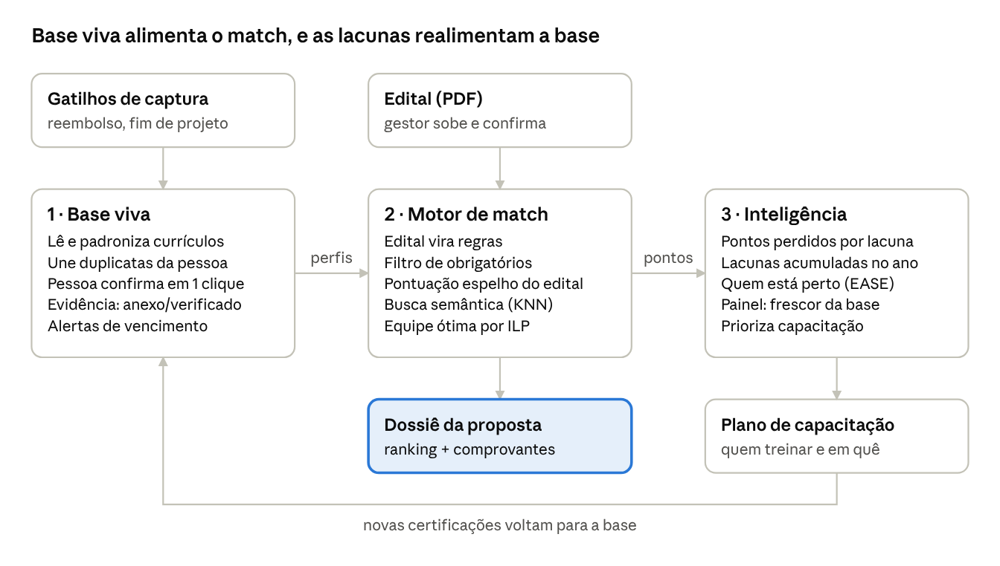

# HackatOhm 2026 — Plano de Ataque: Base Viva de Competências para Licitações

Oct 19, 2026 · @Bernardo Vieira Rocha

## Resumo executivo

A tese: o problema não é "achar a pessoa", é **manter uma prova viva de quem sabe o quê** — e só depois ranquear contra o edital. Por isso a solução tem três pilares, nesta ordem de importância:

1. **Base viva (processo + incentivo):** capturar certificações e projetos nos momentos em que a empresa *já fica sabendo* deles (reembolso de curso, fim de projeto, vencimento), e pedir ao colaborador só uma confirmação de 2 minutos, nunca um cadastro do zero.
2. **Motor de match explicável:** transformar o edital em regras (obrigatório × pontuável × teto), filtrar quem atende, pontuar exatamente como o edital pontua e montar a melhor equipe respeitando disponibilidade. Similaridade semântica (KNN com embeddings) e RAG entram para achar evidências em texto livre, e um juiz calibrado (Jev ou LLM local) decide se cada requisito foi atendido, com confiança; a nota final é sempre a regra do edital.
3. **Inteligência para o gestor:** mostrar lacunas ("perdemos X pontos por falta de Y"), quem está mais perto de tirar uma certificação (aqui o EASE/co-ocorrência brilha) e onde investir em capacitação.

O que já temos de evidência: rodamos uma análise nos 228 currículos da base e um match de teste com o edital-exemplo do briefing. Os números aparecem na seção de diagnóstico e servem de roteiro para o pitch.

Nome provisório sugerido para a solução: **Lastro** (lastro = a comprovação que sustenta a nota técnica). Troquem à vontade.

## O que o desafio realmente pede

A entrega fecha às **23h de 27/10/2026**; sem texto ou vídeo, a equipe é desclassificada (Art. 21). A pergunta central da empresa: *como encontrar rápido os profissionais mais aderentes ao edital, apresentar a experiência deles da melhor forma e manter a base viva e atualizada.*

**Entregas obrigatórias e opcionais**

| Item | Regra | Fonte |
| --- | --- | --- |
| Texto de 2 páginas | Problema, solução, fundamentação, resultados obtidos ou esperados | Regulamento, Art. 20, I |
| Parágrafo de 150 a 200 palavras | Afinidade entre a área da empresa parceira e as competências do CEFET-MG; dentro do texto de 2 páginas | Art. 20, § 6º |
| Vídeo pitch | Até 5 minutos, solução + diferenciais | Art. 20, II |
| Protótipo | Opcional; separar o que foi feito do que é previsto | Art. 20, §§ 1º e 2º |
| Lógica de escolha | Como a solução compara exigências do edital com profissionais | Briefing |
| Diagnóstico + impacto quantificado | Premissas explícitas, horas, custo, licitações perdidas | Briefing |
| Riscos de implantação | "O que pode dar errado" | Briefing |

**Como seremos avaliados — duas réguas que precisamos atender ao mesmo tempo**

| Regulamento (Art. 23, pesos iguais, 0–10 cada) | Briefing da empresa (pesos falados) | Onde atacamos |
| --- | --- | --- |
| Aderência ao desafio | — | Os 3 pilares respondem exatamente às 3 partes da pergunta central |
| Viabilidade técnica | Qualidade e viabilidade da solução (25%) | Só tecnologia que existe hoje; custo baixo; protótipo rodando |
| Potencial de impacto | Estimativa de impacto bem fundamentada | Seção de impacto com premissas e faixa |
| Qualidade da apresentação e fundamentação | Comunicação (vídeo) | Roteiro de pitch com dados da base |
| Inovação e originalidade | Criatividade e diferenciação | Base viva por gatilhos + inteligência de lacunas, não só "um buscador" |
| — | Entendimento e quantificação do problema (20%) | Diagnóstico com evidências da própria base |

Os critérios de desempate do regulamento são, em ordem: aderência, viabilidade, inovação (Art. 25, § 1º). Ou seja: **acertar o problema e ser viável vale mais que ser exótico.**

**Restrições que mudam decisões técnicas**

- **Confidencialidade dos dados (Art. 29, § 4º):** é vedado usar os dados fornecidos em plataformas não autorizadas pela empresa. Antes de mandar currículos para uma API de LLM externa, precisamos de autorização (ver Dúvidas).
- **Autoria e transparência (Arts. 17 e 34):** citar bibliotecas, modelos e fontes; deixar explícita a contribuição original.
- **Sem pessoas externas na elaboração (Art. 18, § 2º).**
- **Veracidade (briefing):** nada de tecnologia inventada; tudo que dissermos ser possível precisa ser possível hoje.

## Diagnóstico: a dor e o que a base revelou

A própria base de exemplo reproduz a dor descrita no briefing: currículos sem dono, em formatos livres, desatualizados e com certificações difíceis de achar. Isso é ouro para o pitch — não precisamos supor o problema, podemos mostrá-lo.

**A dor, em cadeia (do briefing)**

1. Receita vem de licitações; a nota técnica depende de certificações e experiência *comprovada* de pessoas.
2. A empresa só sabe o que o colaborador declarou na contratação; depois disso a informação envelhece.
3. Currículos ficam espalhados (Drive pessoal, e-mails antigos, pasta de um gerente).
4. Na hora do edital, gestores perguntam no chat "quem tem a certificação X?" — a busca é manual, os melhores perfis ficam de fora e a pessoa certa pode estar indisponível.
5. Resultado: 40 disputas/ano, cada uma consumindo 15–25 h de 2–3 gestores, e pontos técnicos deixados na mesa.

**O que medimos nos 228 currículos (.docx, em inglês, perfis de TI)**

| Achado | Número | Por que importa |
| --- | --- | --- |
| Formato | 228 arquivos Word, 152 com tabelas, de 124 a 6.589 palavras (mediana 2.573) | Não há padrão; extração precisa ser robusta |
| Perfis | \~45% dev Java/fullstack, \~20% BA/BSA, \~18% gerente de projeto, \~8% scrum master | Base enviesada para TI; editais de engenharia/energia terão poucos candidatos |
| Sem nenhuma certificação detectável | 142 (62%) | Ou não têm, ou não declararam — o sistema não sabe distinguir |
| Têm seção explícita "Certifications" | 45 (20%) | No resto, a certificação está perdida no meio do texto |
| Certificações mais citadas | CSM 32, Six Sigma 32, PMP 29, ITIL 20, SAFe 20, Oracle 18 | Catálogo inicial de certificações a normalizar |
| Informam validade da certificação | 1 caso ("PMP Expiration Date: February 6th 2020") | Quase ninguém diz se ainda vale — risco direto na licitação |
| Ano mais recente citado no currículo | 57% param em 2016–2017 | Base congelada há \~9 anos: o retrato da "base que desatualiza" |
| Mesma pessoa, versões diferentes | Ex.: dois currículos de "Pessoa A" com mesmo e-mail e telefone, só 34% de texto em comum | Qual versão é a verdadeira? Precisa de resolução de entidade |
| Arquivo com nome de outra pessoa | "CV-001.docx" é idêntico a "CV-002.docx" | Nome do arquivo não identifica o dono |
| Dados pessoais sensíveis | E-mail 78%, telefone 76%, e \~30% com SSN parcial, data de nascimento ou status de visto | LGPD: minimizar o que entra na base |

As contagens vêm de extração por dicionário + regex (script em Python), então são aproximadas; servem como evidência de ordem de grandeza, não como verdade absoluta. Vale citar isso no texto para cumprir o princípio de veracidade.

**Teste de fumaça do match** — edital-exemplo do briefing (gerente de projeto; PMP pontua; 2 pts por projeto no setor de energia, teto 8): dos 60 perfis PM/SM, 28 citam PMP, 8 têm algum projeto de energia e só **4 têm os dois**. Os dois primeiros do ranking eram a **mesma pessoa** (as duas versões da Pessoa A). Sem deduplicação, o gestor veria o mesmo nome duas vezes e acharia que tem mais opções do que tem.

## Quantificação do problema

Só o tempo de busca custa à empresa entre **R$ 84 mil e R$ 250 mil por ano**, e o custo maior é invisível: cada ponto técnico perdido pesa como cobrar mais caro na proposta.

**Custo direto (horas de gestor)**

| Premissa | Valor | Origem |
| --- | --- | --- |
| Disputas por ano | 40 | Briefing |
| Horas por disputa (2–3 gestores somados) | 15 a 25 h | Briefing |
| Horas por ano | 600 a 1.000 h | 40 × 15 a 40 × 25 |
| Salário médio de gerente de projetos de TI | R$ 14.040/mês (CAGED, últimos 12 meses) | [salario.com.br](https://www.salario.com.br/profissao/gerente-de-projetos-de-tecnologia-da-informacao-cbo-142520/) |
| Custo-hora com encargos (premissa nossa: +70% de encargos, 168 h/mês) | \~R$ 140/h; diretores puxam para \~R$ 250/h | Estimativa — validar com a empresa |
| **Custo anual** | **R$ 84 mil (600 h × R$ 140) a R$ 250 mil (1.000 h × R$ 250)** | Cálculo |

**Custo de oportunidade (o argumento mais forte)**

Em técnica e preço pela Lei 14.133, a técnica pesa no máximo 70%. O modelo de edital do Ministério dos Transportes usa:

```latex
NF = 0{,}7 \cdot NT + 0{,}3 \cdot NP, \quad NT = 100 \cdot \frac{T_{licitante}}{T_{melhor}}, \quad NP = 100 \cdot \frac{P_{menor}}{P_{licitante}}
```

Consequência que vale um slide: se a melhor proposta técnica soma 100 pontos e nós perdemos 8 por não achar quem tem experiência em energia, a nota final cai 5,6. Para perder 5,6 pontos pelo preço, precisaríamos cobrar cerca de **23% a mais** que o concorrente mais barato. **Esquecer quem tem a certificação custa o mesmo que inflar o preço em 23%. E isso acontece de verdade: na concorrência 31/2025 da AGEVAP, duas empresas perderam 4 dos 40 pontos de equipe por documento de profissional "não apresentado" (seção Editais reais).**

Receita perdida: falta o valor médio de contrato (pergunta para a empresa). Se o match melhor virar 1 a 2 das 40 disputas por ano, o ganho é 1 a 2 vezes esse ticket — quase certamente uma ordem de grandeza acima do custo de horas.

**Custos qualitativos** (citar, não somar): certificação vencida descoberta tarde, profissional indicado que está alocado (o Art. 38 da Lei 14.133 exige participação pessoal e direta de quem pontuou), e talentos que se sentem invisíveis.

## Visão geral da solução

Os três pilares formam um ciclo: a base viva alimenta o match, o match gera o dossiê e o histórico de pontos, e as lacunas encontradas viram capacitação que volta para a base.



O ciclo é o diferencial frente a "um buscador de currículos": quanto mais editais passam pelo sistema, mais fresca a base e mais precisa a decisão de onde investir.

## Pilar 1 — Coleta e base viva

Princípio: **o colaborador confirma, não digita.** A empresa já fica sabendo de quase toda certificação e projeto em algum momento do processo; o sistema captura nesse momento e só pede um clique de confirmação. Isso ataca a "preguiça do usuário" que o briefing citou, em vez de depender de boa vontade.

**Carga inicial (uma vez)**

1. Importar os currículos existentes (.docx/.pdf) e extrair para um formato padrão: pessoa, certificações (nome, emissor, data, validade, ID da credencial), projetos (cliente, setor, papel, período, tecnologias), formação.
2. Normalizar com um catálogo de certificações: "Certified Scrum Master", "CSM®" e "SCRUM MASTER certificado" viram o mesmo item, com regra de validade (ex.: PMP exige renovação a cada 3 anos).
3. Resolver duplicatas por e-mail/telefone (caso Pessoa A) e mandar para o colaborador revisar *o rascunho já preenchido* do próprio perfil.

**Gatilhos que mantêm a base viva (o diferencial)**

| Momento | Quem dispara | O que entra na base | Esforço do colaborador |
| --- | --- | --- | --- |
| Empresa reembolsa curso ou prova | RH/financeiro | Certificação em "pendente de comprovante" | Subir o PDF ou link do selo |
| Colaborador recebe certificado | Colaborador encaminha o e-mail ou PDF para um endereço da empresa | Parser lê o documento e cria o registro | Encaminhar + 1 clique |
| Projeto encerra | PMO/gestor | Experiência: cliente, setor, papel, período | 1 clique de confirmação |
| Atestado de capacidade técnica emitido pelo cliente | Comercial | Vincula atestado às pessoas citadas | Nenhum |
| Certificação a 90/30 dias de vencer | Sistema | Alerta para renovar | Renovar e subir |
| Revisão trimestral | Sistema | Perfil pré-preenchido para confirmar | \~2 minutos |

**Incentivos (cultura sem depender só de boa vontade)**

- **Bônus de licitação:** quem teve o perfil usado numa proposta vencedora recebe reconhecimento ou bonificação. Liga o incentivo ao resultado que a empresa quer, não ao ato de preencher.
- **Reembolso condicionado:** a empresa paga a certificação, e o reembolso é liberado quando o comprovante entra na base.
- **Visibilidade de carreira:** "seu perfil foi pré-selecionado para 3 propostas este trimestre". Dá ao colaborador um motivo para manter o perfil, inclusive para o perfil "dono da própria carreira" citado no briefing.
- **Indicador de completude do perfil** visível para o colaborador e para o gestor dele (sem ranking público, para não constranger).

**Governança mínima**: um dono da base (RH ou PMO) com meta de completude, e a revisão trimestral como processo formal. Como disseram na reunião: parte disso *tem* que ser processo — a tecnologia só reduz o atrito.

**Dúvida a decidir no time:** bônus em dinheiro ou reconhecimento/benefício? Dinheiro é mais forte mas tem custo; propor as duas opções com custo estimado e deixar a empresa escolher.

## Pilar 2 — Motor de match (a lógica de escolha)

Recomendação: o ranking final deve **pontuar exatamente como o edital pontua**, de forma determinística e explicável; KNN/embeddings entram para *encontrar evidências* em texto livre, e otimização entra para *montar a equipe*. Um modelo de similaridade sozinho não sabe que "2 pts por projeto, teto 8" ou que certificação vencida vale zero — e a banca do TCU exige pontuação objetiva e fundamentada, então o gestor precisa conseguir explicar cada ponto.

**O pipeline em 5 passos**

1. **Edital → regras.** O gestor sobe o PDF; um LLM sugere a tabela de requisitos e o gestor confirma (o briefing pediu para não focar no edital, então a confirmação humana é a salvaguarda). Cada regra tem: papel (ex.: gerente de projeto), tipo (obrigatório × pontuável), critério (certificação X, experiência no setor Y, anos), pontos por unidade, teto, e se exige comprovação vigente.
2. **Filtro duro.** Remove quem não atende a algum obrigatório na data da proposta (inclui validade da certificação).
3. **Pontuação espelho do edital.** Para cada pessoa e papel, soma os pontos exatamente pela regra, só contando o que tem evidência. Saída: "18 pts = PMP (10) + 4 projetos de energia (8, teto atingido)".
4. **Busca semântica para requisitos em texto livre.** "Experiência em projetos do setor elétrico" não aparece igual no currículo. Embeddings multilíngues (o edital é em português, a base em inglês) + KNN por similaridade de cosseno, combinados com busca por palavra-chave (BM25), trazem os trechos candidatos; o gestor confirma com um clique. Modelos abertos que fazem isso hoje: família `sentence-transformers` multilíngue, rodando local, sem mandar dados para fora.
5. **Montagem da equipe por otimização.** Escolher o melhor gerente, o melhor arquiteto etc. *separadamente* pode alocar a mesma pessoa duas vezes ou alguém sem agenda. Formulamos como programação linear inteira: maximizar a pontuação total, uma pessoa por papel, cada pessoa em no máximo um papel, respeitando disponibilidade. Com dezenas de pessoas e poucos papéis, OR-Tools ou PuLP resolvem em milissegundos. Isso responde ao "sem força bruta" do áudio.

**Desempate** (a pergunta feita na reunião): mais tempo de validade restante → mais disponibilidade no período do contrato → mais evidências comprovadas → experiência mais recente. Configurável por edital, porque como disseram, depende do tipo de certificação e do edital.

**"Apresentar a experiência da melhor forma"**: a saída não é só um ranking, é um **dossiê da proposta** — currículo de cada indicado gerado no formato que o edital pede, com os comprovantes anexados e a memória de cálculo dos pontos. Isso corta a parte mais braçal das 15–25 h.

**Onde KNN e EASE entram, sendo honestos com a banca**

| Técnica | Bom para | Não serve para |
| --- | --- | --- |
| Regras + pontuação espelho | Ranking final, auditável | Entender texto livre |
| Embeddings + KNN | Achar evidência de experiência em texto livre; achar "pessoas parecidas com o perfil ideal" | Decidir pontos (similaridade alta ≠ requisito cumprido) |
| EASE (autoencoder linear item-item) | Aprender quais certificações/skills andam juntas → prever quem está perto de tirar uma certificação (Pilar 3) | Ranquear contra um edital: não conhece pontos, tetos nem validade |
| Programação inteira (ILP) | Montar a equipe ótima com restrições | — |

### Camada de IA: RAG + juiz calibrado (Jev)

A busca semântica do passo 4 vira um **RAG completo**: recuperar trechos e deixar um modelo decidir sobre eles, sempre citando a fonte. Para a decisão, propomos um **juiz calibrado**, o [Jev](https://typesafe.ai/blog/introducing-system-one-models-and-jev) (TypeSafe AI, set/2026). Ele não gera texto: devolve respostas tipadas (classificar, pontuar, escolher entre até 255 opções) com probabilidade e confiança calibradas, em 70–500 ms.

**Fluxo de decisão por requisito**

1. **Recuperar:** para cada regra do edital ("atestado de saneamento", "experiência em energia"), embeddings multilíngues + BM25 trazem os trechos mais relevantes dos currículos e atestados de cada pessoa.
2. **Decidir:** o juiz recebe requisito + trechos e devolve `atende | não atende | incerto`, a confiança e o ID do trecho usado.
3. **Pontuar:** as regras do edital somam os pontos só dos itens "atende" com evidência anexada. O modelo nunca dá a nota final.
4. **Revisar:** confiança abaixo do limiar (ex.: 0,8) ou "incerto" vai para a fila do gestor, com o trecho já destacado.

**Onde cada modelo entra**

| Tarefa | Modelo | Por quê |
| --- | --- | --- |
| Requisito atendido? (Pilar 2) | Juiz calibrado (Jev) | Decisão tipada com confiança; sem texto livre, não inventa certificação |
| Tipo de documento enviado: certificado, atestado, CAT, diploma; vencido? (Pilar 1) | Juiz calibrado (Jev) | Automatiza os gatilhos da base viva |
| Triagem de editais: técnica e preço? pontua equipe? setor? | Juiz calibrado (Jev) | Filtra o que o script do PNCP traz |
| Edital → regras em JSON | LLM com RAG sobre o PDF | Precisa extrair estrutura, com a página de origem de cada regra |
| Dossiê da proposta e busca em linguagem natural | LLM com RAG | Precisa gerar texto, só a partir de trechos citados |

**Plano B por desenho:** o juiz é um componente com interface única (`requisito + trechos → decisão + confiança + trecho`). Há duas implementações: Jev, ou um LLM local (via Ollama) forçado a responder em JSON. Se o Jev não liberar acesso ou a empresa não autorizar API externa, troca-se a implementação sem mexer no resto.

**Riscos específicos e mitigação**

- **Acesso:** o site oficial fala em acesso antecipado; o modelo aparece listado no [OpenRouter](https://openrouter.ai/compare/~typesafe/jev-latest). Testar o acesso no dia 20/10 e, se falhar, seguir com o plano B.
- **Confidencialidade (Art. 29, § 4º):** é API externa; só usar com currículos fictícios até a empresa autorizar.
- **Português:** o suporte não está documentado; validar com editais reais.
- **Números do fornecedor:** "0% de alucinação" e o preço (US$ 0,042 por milhão de tokens de entrada, saída grátis) são declarações da própria empresa, que admite que a métrica "não é empírica" e que o preço pode ser subsidiado. **Medimos nós mesmos:** \~30 pares requisito × pessoa rotulados à mão, comparando acerto e calibração do Jev contra o LLM local. Esse número entra no texto como resultado obtido.

## Pilar 3 — Inteligência para o gestor

Cada edital processado vira um dado: o que foi pedido, quantos pontos conseguimos, quantos deixamos na mesa e por quê. Com isso o sistema deixa de só responder "quem tem X" e passa a dizer **onde investir**. É a terceira parte da ideia do áudio, e é viável justamente porque os Pilares 1 e 2 geram os dados.

**Três análises, da mais simples à mais sofisticada**

1. **Mapa de lacunas por edital:** "neste edital perdemos 8 de 30 pontos: ninguém com experiência comprovada em energia". Sai direto da pontuação espelho.
2. **Ranking de lacunas acumuladas:** somando todos os editais do ano — "certificação ITIL apareceu em 12 editais e nos custou 40 pontos no total". Prioriza o orçamento de capacitação por pontos ganhos, não por intuição.
3. **Quem está mais perto de cobrir a lacuna:** com a matriz pessoa × certificação/skill, um modelo item-item (EASE ou co-ocorrência simples) estima, para cada pessoa, a afinidade com a certificação que falta. Ex.: quem tem CSM e trabalha com SAFe tende a ser o candidato mais rápido a um PSM ou SAFe Agilist. O gestor recebe: "3 pessoas com maior chance de tirar ITIL em 2 meses".

**Painel do gestor (protótipo)**

- Completude e frescor da base (% de perfis confirmados nos últimos 90 dias).
- Certificações vencendo nos próximos 90 dias.
- Top 5 lacunas por pontos perdidos no ano.
- Disputas: horas gastas antes × depois (para provar o impacto).

**Cuidado de veracidade:** com 228 currículos sem histórico de licitações, o EASE pode ser demonstrado na base (aprender co-ocorrências reais entre certificações), mas a análise de "pontos perdidos" precisa de editais simulados. Vamos dizer isso claramente no texto: *resultado obtido* = co-ocorrência e ranking na base; *resultado esperado* = ganho de pontos com histórico real.

## Comprovação, privacidade e veracidade

Os três "pontos de atenção" que a empresa listou viram requisitos de projeto, não notas de rodapé.

**Comprovação (experiência só conta se comprovada)**

- Cada certificação ou experiência tem um **status de evidência**: declarado → comprovante anexado → verificado. Só "comprovante anexado" ou acima pontua no motor.
- Verificação rápida onde existe registro público: o PMI mantém um registro online de certificados consultável; selos digitais (ex.: Credly) têm link público verificável. Na base, já aparecem números de PMP nos currículos, o que viabiliza essa checagem.
- Atestados de capacidade técnica emitidos por clientes ficam vinculados às pessoas e projetos que citam; o dossiê sai com eles anexados.

**Privacidade (LGPD)**

- **Minimização:** a base guarda competências e evidências, não dados que não servem à finalidade. Na nossa amostra, \~30% dos currículos traziam SSN parcial, data de nascimento ou status migratório — isso é descartado na ingestão.
- **Finalidade e transparência:** o colaborador é informado de que o perfil serve para propostas técnicas e vê/edita o próprio perfil a qualquer momento.
- **Acesso por papel:** gestor de proposta vê competências, evidências e disponibilidade; contato e documentos pessoais só RH. Toda consulta fica em log de auditoria.
- **Processamento local quando possível:** embeddings e extração com modelos abertos rodando na infraestrutura da empresa evitam mandar currículos a terceiros. Se usarmos API externa de LLM, precisa de contrato/termos que vedem retenção — e, no hackathon, autorização da empresa (Art. 29, § 4º).

**Veracidade (não inventar tecnologia)**

Tudo citado no plano existe e é usado hoje: extração de .docx/PDF (python-docx, pdfplumber), LLMs para extração estruturada, `sentence-transformers` multilíngue, BM25, RAG, Jev (TypeSafe AI) ou LLM local via Ollama, EASE (Steck, 2019), OR-Tools/PuLP. No texto e no vídeo, separar com rótulos claros **"funcionando no protótipo"** de **"previsto"** (o regulamento exige essa distinção, Art. 20, § 2º).

## Impacto esperado

Meta defensável para o pitch: cortar as 15–25 h por disputa para **3–6 h**, liberando \~480–760 h de gestor por ano (\~R$ 67 mil a R$ 190 mil, pelas premissas acima), e — mais importante — parar de perder pontos técnicos por desconhecimento.

| Alavanca | Antes | Depois (esperado) | Como medir |
| --- | --- | --- | --- |
| Tempo de montagem da equipe técnica | 15–25 h/disputa, 2–3 gestores | 3–6 h: confirmar regras, revisar ranking, aprovar dossiê | Registro de horas por disputa, antes × depois |
| Pontos técnicos | Perdidos quando ninguém lembra quem tem o requisito | Pontuação máxima possível com o quadro atual, calculada e mostrada | Pontos obtidos ÷ pontos máximos possíveis |
| Certificação vencida na proposta | Descoberta tarde (ou nunca) | Alerta 90/30 dias antes | Nº de certificações vencidas usadas = 0 |
| Frescor da base | Base congelada (na amostra, 57% param em 2016–17) | ≥ 80% dos perfis confirmados nos últimos 90 dias | Painel de completude |
| Capacitação | Por intuição | Priorizada por pontos perdidos acumulados | Lacunas fechadas por trimestre |
| Talentos | Invisíveis se não "levantam a mão" | Visíveis por evidência | Nº de pessoas diferentes indicadas no ano |

As faixas de horas "depois" são estimativa nossa (premissa a validar com a empresa), não medição. Citar como esperado.

**Custo da solução**: baixo. Roda com bibliotecas abertas; o custo variável é extração por LLM na carga inicial e em cada documento novo — algumas centenas de currículos são poucos milhões de tokens, coisa de dezenas de dólares em modelos pequenos, ou zero com modelo local. Nada na faixa dos "2 bilhões" que a empresa citou como exemplo do que não é viável.

## Riscos de implantação

O maior risco é de adesão, não de tecnologia — e a banca pediu justamente para mostrarmos que sabemos onde a solução ainda é frágil.

| Risco | Probabilidade | Impacto | Mitigação |
| --- | --- | --- | --- |
| Colaboradores não confirmam o perfil | Alta | Alto | Gatilhos automáticos (reembolso, fim de projeto) geram a maior parte dos dados sem depender deles; bônus de licitação; revisão trimestral formal |
| Extração automática erra (certificação inexistente ou não detectada) | Média | Alto | Nada pontua sem confirmação humana + comprovante; medir precisão numa amostra rotulada à mão |
| Gestor confia cegamente no ranking | Média | Médio | Memória de cálculo por ponto; o gestor aprova o dossiê |
| Edital com regra ambígua ou fora do padrão | Alta | Médio | Regras confirmadas pelo gestor; fallback para busca livre |
| Vazamento ou uso indevido de dados pessoais | Baixa | Alto | Minimização, acesso por papel, log, processamento local |
| Bônus gera incentivo a inflar o perfil | Média | Médio | Só pontua evidência verificada; bônus atrelado a proposta vencedora, não a volume |
| Indicado não está disponível na execução (Art. 38 exige participação pessoal) | Média | Alto | Disponibilidade como restrição no ILP; integração com alocação/timesheet |
| Base de exemplo é de TI em inglês; a empresa pode ter perfis de engenharia | Alta | Médio | Pipeline independente de domínio; catálogo de certificações extensível (ex.: CREA/CAT para engenharia) |

## Plano de execução (19 → 27/10) e divisão do time

Temos 8 dias; o plano trava funcionalidades no sábado 24/10 e deixa domingo e segunda para texto e vídeo, com entrega às 18h do dia 27 (5 h de folga antes do prazo).

**Frentes (seguindo a divisão do áudio + uma frente de negócio)**

| Frente | Responsável | Entrega principal |
| --- | --- | --- |
| A. Base viva | a definir | Desenho do processo, gatilhos, incentivos com custo; pipeline de extração da base para JSON padronizado |
| B. Motor de match | a definir | Edital → regras, pontuação espelho, busca semântica, ILP da equipe, desempate |
| C. Inteligência + protótipo | a definir | EASE/co-ocorrência, painel do gestor, interface (ex.: Streamlit) |
| D. Negócio e narrativa | a definir | Diagnóstico, quantificação, riscos, texto de 2 páginas, parágrafo do § 6º, roteiro e edição do pitch |

**Checklist por dia**

- [ ] **19–20/10:** cada um faz a manifestação individual no SIGAA (prazo 19–20/10, necessária para as horas de extensão); mandar as dúvidas abaixo aos mentores; baixar 2–3 editais reais; fechar o nome e a divisão de frentes.
- [ ] **21/10:** extração estruturada dos 228 currículos (JSON), catálogo de certificações normalizado, deduplicação; 3 editais simulados escritos a partir dos reais.
- [ ] **22–23/10:** motor de match ponta a ponta nos editais simulados; processo e incentivos desenhados; planilha de quantificação com premissas.
- [ ] **24/10 (sábado):** protótipo navegável + painel; **congelar funcionalidades à noite**.
- [ ] **25/10 (domingo):** rascunho do texto de 2 páginas + parágrafo de 150–200 palavras; roteiro do pitch (5 min).
- [ ] **26/10:** gravar e editar o vídeo; revisão com mentores.
- [ ] **27/10:** ajustes finais; **entregar até 18h**.

**Roteiro sugerido do pitch (5 min)**

1. 0:00–0:45 — A dor com dados da própria base (62% sem certificação visível, base parada em 2017, a mesma pessoa aparecendo duas vezes) e um caso real: a Lima Engenharia desclassificada na AMEP-PR porque o coordenador indicado não atingiu o mínimo de pontos.
2. 0:45–1:30 — Quanto custa: R$ 84–250 mil/ano em horas e o "8 pontos = 23% de preço".
3. 1:30–3:30 — Demo: sobe edital → regras → ranking explicado → equipe ótima → dossiê; depois o colaborador confirmando um certificado em 1 clique.
4. 3:30–4:30 — Base viva + inteligência de lacunas (o diferencial).
5. 4:30–5:00 — Riscos assumidos, custo baixo, próximo passo.

## Dúvidas em aberto (para mentores e empresa)

Nenhuma bloqueia o início: para cada uma já existe uma premissa padrão que usamos até a resposta chegar.

| # | Pergunta | Por que importa | Premissa até a resposta |
| --- | --- | --- | --- |
| 1 | Qual o nome exato da empresa parceira e sua área de atuação? (a transcrição ficou ambígua) | Obrigatório para o parágrafo de 150–200 palavras do § 6º | Consultoria de gestão, tecnologia e dados |
| 2 | A avaliação usa os 5 critérios de peso igual do regulamento (Art. 23) ou os pesos falados no briefing (25%, 20%…)? | Define onde gastar esforço | Atender às duas réguas (tabela da seção 2) |
| 3 | Podemos enviar os currículos a APIs externas de LLM? (Art. 29, § 4º) | Muda a arquitetura de extração | Não: regex + modelo local; LLM externo e Jev só com currículos fictícios |
| 4 | Os perfis reais da empresa são só TI, ou também engenharia/energia? Podemos criar currículos fictícios em português? | A base é toda TI e em inglês | Criar 10–20 currículos fictícios em PT para cobrir editais de engenharia |
| 5 | Valor médio de contrato e taxa de vitória atual nas licitações | Quantificar receita perdida | Mostrar fórmula e cenário com ticket a preencher |
| 6 | Custo-hora real dos gestores e tamanho do quadro | Custo direto | R$ 140–250/h; quadro desconhecido |
| 7 | Licitações são majoritariamente públicas (Lei 14.133) ou privadas? | Regras privadas não seguem a lei | Modelo genérico de regras, exemplos públicos |
| 8 | Existe sistema de RH, alocação ou timesheet para integrar disponibilidade e fim de projeto? | Viabilidade dos gatilhos | Integração via exportação CSV/planilha |
| 9 | Já existe reembolso de certificações? Bonificação em dinheiro é aceitável na cultura? | Desenho de incentivo | Propor 2 opções com custo |
| 10 | O escopo inclui certificações da empresa (ex.: ISO) além das pessoas? | O briefing citou as duas | Foco em pessoas; empresa como extensão |

## Editais reais: o que encontramos

Em editais reais de técnica e preço de 2025–2026, **a equipe responde por 30% a 54% da nota técnica, e empresas perdem pontos ou são desclassificadas por não apresentar a comprovação de um profissional** — exatamente a dor do briefing, agora documentada.

| Licitação | Objeto | Peso da equipe | O que aconteceu |
| --- | --- | --- | --- |
| [AMEP-PR, Concorrência 02/2026 (ata de julgamento)](https://www.amep.pr.gov.br/sites/comec/arquivos_restritos/files/documento/2026-05/ce_02-26_-_ata_de_julgamento_anexos_r02.pdf) | Projetos executivos BIM de parque | Equipe = 41 dos 76 pontos do vencedor (54%) | A Lima Engenharia foi **desclassificada** porque o coordenador indicado somou 6 pontos, abaixo do mínimo de 8 — mesmo com nota razoável nos outros quesitos. A banca pontuou só um profissional por função, o de mais atestados |
| [AGEVAP, Concorrência 31/2025 (nota técnica)](https://www.agevap.org.br/sisatos/nota-tec-concorrencia-31-2025.pdf) | Planos municipais de saneamento (consultoria) | Equipe = até 40 de 100 | Ampla e Engecorps ficaram com 36 de 40 na equipe por atestado ou pós-graduação **"não apresentado"** ou fora do objeto; a Hidrobr foi desclassificada por irregularidade da engenheira no conselho. O vencedor fez 95,58; o 5º, 83,33 |
| [SECID-PR, critérios de pontuação](https://www.secid.pr.gov.br/sites/default/arquivos_restritos/files/documento/2024-12/09_09_criterios_de_pontuacao_-_analise_tecnica_e_de_precos.pdf) | Obra e projeto de edifício cultural | Equipe = 30 de 100 | 15 itens de experiência da equipe, 1 ponto por CAT válida, tetos de 1 a 3 por item, vínculo comprovado e troca de profissional só com experiência equivalente |
| [BRDE, Edital 2026/098](https://brde.com.br/wp-content/uploads/2026/06/2026_098-Edital-e-anexos.pdf) | Consultoria em estudos ferroviários | Técnica 7 × preço 3 | Confirma o peso de 70% para a técnica; tabela de pontos fica no Anexo IV (não publicado no mesmo PDF) |

**O que isso muda no nosso plano**

1. **A unidade da base é o atestado/CAT por projeto, não só a certificação.** Nos editais reais, a experiência comprovada vale mais que selos como PMP — o TCU desestimula pontuar "tempo de experiência" genérico e pede evidência objetiva. O Pilar 1 deve capturar cada atestado e vinculá-lo às pessoas que ele cita.
2. **Mínimos por profissional são eliminatórios.** O motor precisa tratar "nota mínima do coordenador" como restrição dura, e alertar quando o melhor candidato da casa não atinge o mínimo.
3. **Só um profissional por função pontua.** Indicar vários não ajuda; o ILP do Pilar 2 deve escolher o melhor por função, como a própria banca faz.
4. **Vínculo e regularidade no conselho** (CREA/CAU) entram como campos com validade, igual às certificações.
5. **Os editais encontrados são de engenharia e consultoria, não de TI**, enquanto a base de currículos é de TI. Reforça a Dúvida 4: precisamos saber o perfil real da empresa e, provavelmente, criar currículos fictícios em português.

Os portais PNCP e Comprasnet não puderam ser acessados por crawler a partir do nosso ambiente (rede bloqueada), então estes editais vieram de PDFs publicados nos sites dos órgãos. Para mais casos, a busca manual abaixo continua valendo.

**Onde procurar**

- [PNCP — busca de editais](https://pncp.gov.br/app/editais): filtrar por modalidade *Concorrência* e buscar os termos abaixo.
- [Compras.gov.br](https://www.gov.br/compras/pt-br): portal federal citado no briefing.

**Termos de busca que tendem a trazer o que queremos**

- "técnica e preço" consultoria gestão de projetos
- "técnica e preço" fábrica de software
- "técnica e preço" PMP ITIL
- "técnica e preço" consultoria energia elétrica (casa com o exemplo do briefing)

**Ao abrir cada edital**: baixar o edital *e* o anexo Termo de Referência (é lá que fica a tabela); conferir se há pontos por profissional; mandar aqui no chat que eu extraio as regras e monto os editais simulados.

**Referências de estrutura** (não são casos reais de julgamento): o [modelo de edital de técnica e preço do Ministério dos Transportes](https://www.gov.br/transportes/pt-br/assuntos/conjur/modelodeeditalconcorrenciatecnicaeprecoleino14133set25.pdf) (fórmula da nota final) e os [critérios de seleção do TJCE](https://portal.tjce.jus.br/uploads/2024/10/08-CRITERIOS-DE-SELECAO-OMNICHANNEL_6_2023.pdf), que pontuam formação, experiência e PMP numa escala de 0 a 4. As regras dos quatro editais acima estão convertidas em JSON na pasta do repositório (`data/editais/`), prontas para testar o motor.

## Fontes

- Regulamento HackatOhm 2026 (Arts. 17–25, 28 e 29) e transcrição da reunião de briefing — arquivos do projeto.
- Áudio do colega de equipe com a divisão do problema em três partes — arquivo do projeto.
- Análise própria da base de 228 currículos (extração com python-docx + regex; contagens aproximadas).
- [TCU — Licitações e Contratos: técnica e preço](https://licitacoesecontratos.tcu.gov.br/3-4-4-) — limite de 70% para a técnica, quesitos do art. 37, art. 38 e jurisprudência sobre pontuação objetiva.
- [Lei 14.133/2021, art. 67](https://www.legjur.com/legislacao/art/lei_00141332021-67) — qualificação técnico-profissional e substituição de profissional indicado.
- [Ministério dos Transportes — modelo de edital de concorrência técnica e preço](https://www.gov.br/transportes/pt-br/assuntos/conjur/modelodeeditalconcorrenciatecnicaeprecoleino14133set25.pdf) — fórmula da nota final.
- [TJCE — critérios de seleção](https://portal.tjce.jus.br/uploads/2024/10/08-CRITERIOS-DE-SELECAO-OMNICHANNEL_6_2023.pdf) — exemplo de pontuação de profissionais.
- [salario.com.br — Gerente de Projetos de TI (CAGED)](https://www.salario.com.br/profissao/gerente-de-projetos-de-tecnologia-da-informacao-cbo-142520/) — média salarial.
- [PMStudyCircle — registro de certificações do PMI](https://pmstudycircle.com/pmi-registry/) — verificação pública de PMP.

**Editais e julgamentos reais analisados**

- [AMEP-PR — Ata de julgamento da Concorrência Eletrônica 02/2026](https://www.amep.pr.gov.br/sites/comec/arquivos_restritos/files/documento/2026-05/ce_02-26_-_ata_de_julgamento_anexos_r02.pdf)
- [AGEVAP — Nota técnica da Concorrência 31/2025](https://www.agevap.org.br/sisatos/nota-tec-concorrencia-31-2025.pdf) e [nota técnica 75/2026](https://www.agevap.org.br/sisatos/nota-tec-revi-concorrencia-31-2025.pdf)
- [SECID-PR — Critérios de pontuação técnica e de preços](https://www.secid.pr.gov.br/sites/default/arquivos_restritos/files/documento/2024-12/09_09_criterios_de_pontuacao_-_analise_tecnica_e_de_precos.pdf)
- [BRDE — Edital 2026/098 e anexos](https://brde.com.br/wp-content/uploads/2026/06/2026_098-Edital-e-anexos.pdf)

**IA**

- [TypeSafe AI — Introducing System One models and Jev](https://typesafe.ai/blog/introducing-system-one-models-and-jev)
- [OpenRouter — Jev](https://openrouter.ai/compare/~typesafe/jev-latest)
