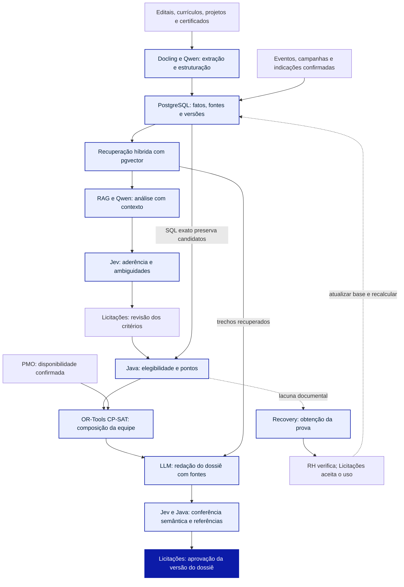

# APTUS — Pipeline técnico para Obsidian

**Canvas visual:** o pacote atualizado inclui `APTUS_Pipeline_e_Plano.canvas`, editável no Obsidian, e `APTUS_Canvas_Premium.svg`, `.png` e `.pdf`, que preservam a apresentação gráfica com fundo grafite, grupos por responsabilidade e plano de implantação. O Mermaid abaixo mantém a topologia detalhada para edição textual.

## Tese da apresentação

A contribuição técnica do APTUS está na qualidade da arquitetura de implementação: um pipeline que integra RAG, LLMs, Jev, regras determinísticas e otimização matemática para transformar documentos dispersos em equipes e dossiês sustentados por evidências rastreáveis. A apresentação explicita controle de custo, revisão humana, segurança, uso autorizado dos dados e implantação gradual como partes dessa engenharia.

O Obsidian renderiza o diagrama Mermaid abaixo. Ele representa a **arquitetura de implementação proposta**. O protótipo visual utiliza dados sintéticos e processamento simulado; ainda não executa estas integrações.

## Responsabilidade de cada componente

| Componente | Papel proposto no Aptus |
|---|---|
| Docling | Organizar texto, tabelas e referências de origem. |
| Qwen / LLM | Extrair e normalizar fatos, propor critérios e redigir a partir de fontes. |
| PostgreSQL / pgvector | Guardar registros versionados e combinar busca estruturada, textual e vetorial. |
| RAG | Recuperar contexto documental e utilizá-lo nas respostas do LLM. |
| Jev | Responder a questões semânticas delimitadas com saídas tipadas; sinalizar ambiguidades e extrapolações. |
| Java | Aplicar critérios aprovados de elegibilidade e pontuação, validar contratos e referências. |
| OR-Tools CP-SAT | Buscar equipes sob restrições; distinguir solução viável de ótima comprovada. |
| RH / Licitações / PMO | Verificar provas, aprovar critérios e dossiês, confirmar disponibilidade, respectivamente. |

**O que sustenta a contribuição de engenharia:** a passagem de informações entre etapas preserva identificadores de documentos, versões, decisões humanas e memória de cálculo. A interpretação semântica alimenta regras verificáveis. O Recovery faz o ciclo voltar à base após o aceite de uma prova, provocando novo cálculo.

**Regras de leitura:** o RAG combina recuperação e geração; não é um modelo independente. Jev não substitui o cálculo da nota nem o otimizador. Saída tipada não comprova correção semântica. Candidatos estruturados conhecidos não são descartados por um corte de similaridade. Receber um arquivo ou verificá-lo no RH não acrescenta pontos: é preciso aceitar seu uso no edital e recalcular. Descoberta e Connect enriquecem a base para oportunidades futuras; versões aprovadas de propostas permanecem preservadas.

## Fontes técnicas

- TypeSafe, documentação de modelos: https://docs.typesafe.ai/models
- Lewis et al., RAG (2020): https://ai.meta.com/research/publications/retrieval-augmented-generation-for-knowledge-intensive-nlp-tasks/
- Google, OR-Tools CP-SAT: https://developers.google.com/optimization/cp/cp_solver

Consulta em 27/10/2026. A divisão de responsabilidades é uma decisão de arquitetura do Aptus. Não se afirma ineditismo global, integração já executada ou vantagem de desempenho já demonstrada.
