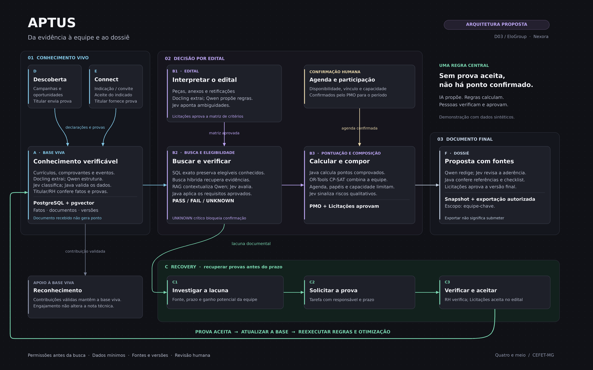

# Aptus — pipeline completo em estilo Obsidian

Visão da arquitetura proposta para o D03 / EloGroup, organizada em conhecimento vivo, decisão por edital e documento final. A demonstração usa dados sintéticos; o diagrama não declara as integrações de produção como executadas.

| Arquivo | Uso |
|---|---|
| **[PNG — 6400 × 4000](APTUS_Pipeline_Obsidian.png)** | Imagem em alta resolução para visualizar, apresentar e usar na montagem do vídeo. |
| **[Canvas editável do Obsidian](APTUS_Pipeline_Obsidian.canvas)** | Nós e conexões em JSON Canvas, sem dependências de outros arquivos. |
| **[SVG vetorial](APTUS_Pipeline_Obsidian.svg)** | Ampliação sem perda de nitidez e uso em ferramentas de edição vetorial. |

## Fluxos representados

- **A — Base Viva:** currículos, comprovantes e eventos; extração, classificação, validação, conferência e base versionada.
- **B — Edital e equipe:** matriz de critérios aprovada, busca híbrida com rota SQL exata, elegibilidade, pontuação e composição sob restrições.
- **C — Recovery:** investigar a lacuna, solicitar a prova, verificar e aceitar para o edital; depois atualizar a base e reexecutar regras e otimização.
- **D — Descoberta:** campanhas e oportunidades geram declarações e provas para conferência.
- **E — Connect:** indicação ou convite, aceite do indicado e documentos fornecidos pelo titular.
- **F — Dossiê:** redação com fontes, revisão, checklist, aprovação humana e exportação da versão exata no escopo de equipe-chave.

Reconhecimento incentiva contribuições válidas, sem alterar a nota técnica. PMO confirma agenda e capacidade; Licitações aprova critérios, aceitação no edital e dossiê. Receber um arquivo, isoladamente, não gera pontos. Exportar não significa submeter.

## Abrir no Obsidian

1. Baixar o arquivo `.canvas` e colocá-lo em uma pasta do cofre.
2. Abrir o arquivo pelo explorador de arquivos do Obsidian.
3. Editar os cartões e as conexões; ajustar o enquadramento antes de capturar a tela.

O canvas contém os mesmos nós e relações da imagem. A aparência dos cartões e o roteamento automático das conexões variam com o tema e com o aplicativo; o PNG e o SVG preservam a composição editorial disponibilizada aqui.

A figura simplificada do [resumo no modelo oficial](../revisao-modelo-oficial/README.md) permanece separada, respeitando o limite de 1/6 de página. Esta visão completa serve à revisão da equipe e à apresentação. A [arquitetura Aptus 3.1](../../aptus-3.1/APTUS_3_1_Blueprint.md) continua sendo a referência técnica.
